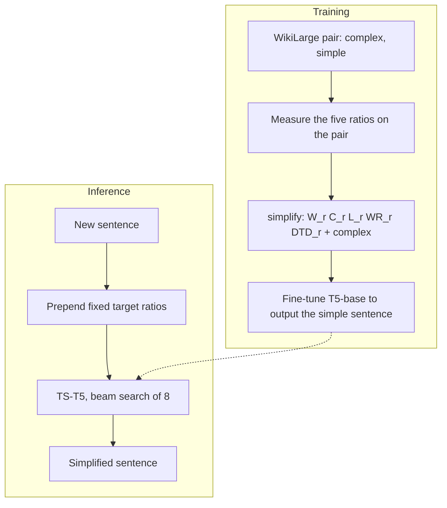
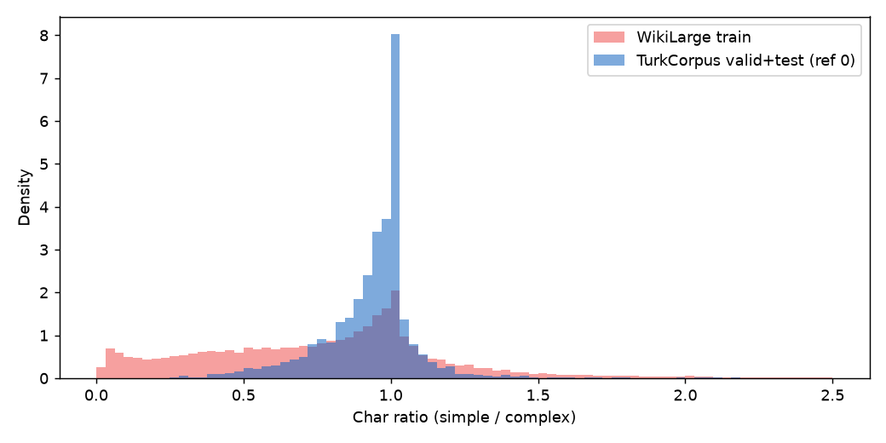
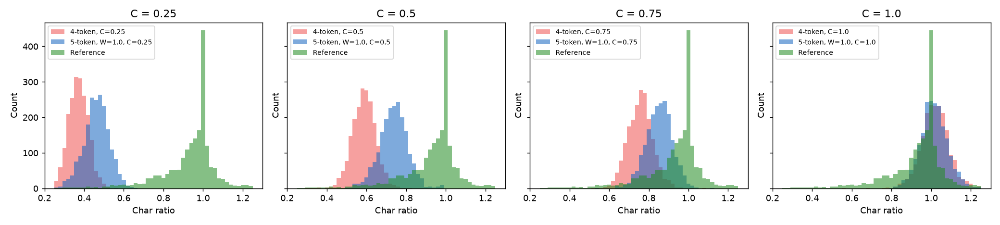
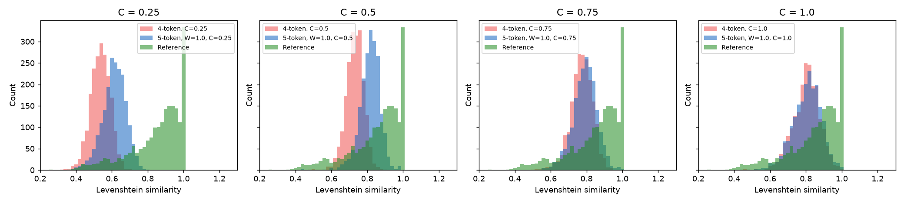
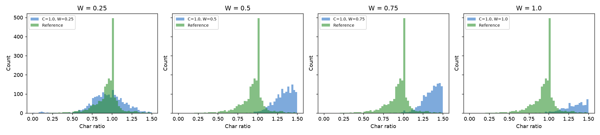

# TS-T5: Controllable Sentence Simplification with T5

[](https://github.com/KimChengSHEANG/TS_T5/actions/workflows/tests.yml)
[](https://aclanthology.org/2021.inlg-1.38)
[](https://huggingface.co/collections/kcsheang/ts-t5-6b02a5b54c77170d51c2f680)
[](LICENSE)

Official code, models, outputs, human ratings and research record for:

> **Controllable Sentence Simplification with a Unified Text-to-Text Transfer Transformer**<br>
> Kim Cheng Sheang and Horacio Saggion<br>
> LaSTUS, TALN, Universitat Pompeu Fabra, Barcelona, Spain<br>
> *Proceedings of the 14th International Conference on Natural Language Generation (INLG 2021)*, pages 341-352, Aberdeen, Scotland, UK<br>
> [Paper](https://aclanthology.org/2021.inlg-1.38) · [PDF](https://aclanthology.org/2021.inlg-1.38.pdf) · [4-token model](https://huggingface.co/kcsheang/ts-t5-base-4tokens) · [5-token model](https://huggingface.co/kcsheang/ts-t5-base-5tokens) · [BibTeX](#citation)

TS-T5 fine-tunes T5-base to rewrite a complex English sentence as a simpler one. Numeric **control tokens** in front of
the sentence say how long the output should be, how close to the source, how common its words and how deep its syntax.

```text
input   simplify: C_0.95 L_0.75 WR_0.75 DTD_0.75  The incumbent was defeated in the election by a substantial margin .
output  The incumbent was defeated in the election by a large amount of votes.
```

## At a glance

| | 4-token model | 5-token model |
|---|---|---|
| Hugging Face | [`kcsheang/ts-t5-base-4tokens`](https://huggingface.co/kcsheang/ts-t5-base-4tokens) | [`kcsheang/ts-t5-base-5tokens`](https://huggingface.co/kcsheang/ts-t5-base-5tokens) |
| Control tokens | C, L, WR, DTD | W, C, L, WR, DTD |
| Default values | 0.95, 0.75, 0.75, 0.75 | 1.05, 0.95, 0.75, 0.75, 0.75 |
| TurkCorpus SARI / BLEU / FKGL | **43.50** / 67.26 / 6.17 | 43.34 / 65.54 / 5.55 |
| ASSET SARI / BLEU / FKGL | 45.05 / 72.24 / 6.33 | **45.26** / 72.19 / 5.92 |
| Strength | fewer tokens to set, same SARI | lower reading grade, fewer dropped words at low C |
| Trained | December 2020 | October 2020 |

**Main results**

1. **Control tokens are most of the gain.** T5-base goes from 37.56 to 43.31 SARI on TurkCorpus and from 34.15 to 45.04
   on ASSET when tokens are added (paper).
2. **It beat the state of the art of the time.** The paper reports +0.69 (TurkCorpus) and +1.41 (ASSET) SARI over
   BART+ACCESS. On the TurkCorpus outputs stored here the margin is +1.26, 95% interval [0.69, 1.85].
3. **The gain comes from adding and deleting the right words**, at some cost in keeping
   ([breakdown](#sari-by-operation)).
4. **Human raters preferred it to YATS and DMASS+DCSS on all three criteria** (p < 0.01). Against BART+ACCESS it is
   rated lower on fluency, with no significant difference on simplicity and adequacy ([details](#human-evaluation)).
5. **The new #Words token lowers reading grade by 0.4 to 0.6** and reduces cropping at low C. It does not change SARI
   measurably ([details](#the-words-token)).
6. **T5-base beats T5-small** by 3.06 (TurkCorpus) and 4.30 (ASSET) SARI without tokens (paper).

**Before you use the numbers or the models**, read the [five practical rules](#five-practical-rules) and the
[errata](#errata-and-clarifications-to-the-paper).

## Contents

- **Use it:** [Quickstart](#quickstart) · [Five practical rules](#five-practical-rules) · [Installation](#installation) · [Command line](#command-line) · [Python API](#python-api)
- **The research:** [Abstract](#abstract) · [Motivation](#motivation) · [Research questions](#research-questions-and-answers) · [Contributions](#contributions) · [Related work](#background-and-related-work)
- **The method:** [Overview](#method-overview) · [Control tokens](#control-tokens) · [Architecture](#architecture) · [Datasets](#datasets) · [Training](#training) · [Inference](#inference) · [Metrics](#metrics)
- **The results:** [Automatic evaluation](#automatic-evaluation) · [Statistical uncertainty](#statistical-uncertainty) · [Human evaluation](#human-evaluation) · [Examples](#examples) · [Error analysis](#error-analysis)
- **The experiments:** [Ablation study](#ablation-study) · [Token sweeps](#single-token-sweeps) · [#Words](#the-words-token) · [Number format](#number-format-experiment) · [Token search](#token-search) · [Other experiments](#other-experiments-and-negative-results) · [Experiment log](#experiment-log)
- **Trust it:** [Reproducibility](#reproducibility) · [Paper vs this repository](#paper-vs-this-repository) · [Errata](#errata-and-clarifications-to-the-paper) · [Threats to validity](#threats-to-validity) · [Limitations](#limitations-and-responsible-use)
- **Build on it:** [Comparing with TS-T5](#comparing-with-ts-t5) · [Open questions](#open-research-questions) · [Repository layout](#repository-layout) · [FAQ](#faq) · [Glossary](#glossary) · [References](#references) · [Citation](#citation)

### How to read the numbers

Several generations of numbers exist for this work. Each table names its kind.

| Label | Meaning |
|---|---|
| **Paper** | As printed in the INLG 2021 paper |
| **Released** | The published output files in [`system_outputs/`](system_outputs/), scored with the pinned EASSE. Use these for comparisons |
| **Archive** | Files and logs of the 2020-22 experiments, from the authors' backup, which is not in the repository |
| **Post-publication** | Analyses made in November 2026 for this repository. They are not peer reviewed and are not in the paper |

---

## Quickstart

```python
import torch
from transformers import T5ForConditionalGeneration, T5TokenizerFast

repo = "kcsheang/ts-t5-base-4tokens"
tokenizer = T5TokenizerFast.from_pretrained(repo)
model = T5ForConditionalGeneration.from_pretrained(repo).eval()


def simplify(sentence, C=0.95, L=0.75, WR=0.75, DTD=0.75):
    # Two decimals, this order and the double space all match the training data.
    text = f"simplify: C_{C:.2f} L_{L:.2f} WR_{WR:.2f} DTD_{DTD:.2f}  {sentence}"
    enc = tokenizer(text, max_length=256, padding="max_length", truncation=True, return_tensors="pt")
    with torch.no_grad():
        out = model.generate(**enc, num_beams=8, do_sample=False, early_stopping=True, max_length=256)
    return tokenizer.decode(out[0], skip_special_tokens=True, clean_up_tokenization_spaces=True)


print(simplify("The incumbent was defeated in the election by a substantial margin ."))
```

For the 5-token model, use `kcsheang/ts-t5-base-5tokens` and put `W_1.05` before `C`.

Do not use `pipeline()`. Transformers 5 has no task for this model, and `pipeline("text-generation")` returns the input
unchanged without raising an error.

### Five practical rules

1. **Give every token the model was trained with.** `--tokens` replaces the defaults, it does not update them. Dropping
   tokens from the 5-token model costs at least 1.08 SARI on TurkCorpus and 5.75 on ASSET.
2. **Keep the order `W C L WR DTD`.** Swapping L and WR costs 0.70 SARI on TurkCorpus and 3.01 on ASSET.
3. **Write values with two decimals when you build the input yourself.** Training saw `C_0.80`, never `C_0.8`, and T5
   tokenises them differently. With `0.80` the median output length is 0.818 of the source, with `0.8` it is 0.882
   ([experiment](#number-format-experiment)). The `ts-t5` command and `Simplifier` do this for you.
4. **Keep two spaces between the last token and the sentence**, as in the training data.
5. **Check the output.** The model can drop, change or invent facts ([error analysis](#error-analysis)).

## Installation

Python 3.10 or newer. CI and the reproduction runs use 3.11.

```bash
git clone https://github.com/KimChengSHEANG/TS_T5.git
cd TS_T5
pip install -e .            # package ts_t5 and the ts-t5 command
pip install -e '.[dev]'     # plus test dependencies
pip install -e '.[search]'  # plus Optuna, for ts-t5 search
```

| Pinned dependency | Version |
|---|---|
| PyTorch | 2.15.0 |
| Transformers | 5.24.0 |
| Lightning | 2.6.6 |
| spaCy | 3.8.18 |
| huggingface_hub | 2.4.0 |
| EASSE | commit `6a4352ec299ed03fda8ee45445ca43d9c7673e89` |

`pip` replaces another installed PyTorch version with the pinned one, so use a virtual environment. `evaluate`, `train`
and `search` read `resources/`, so run them from a checkout. Training also downloads spaCy `en_core_web_sm` and the NLTK
stop words on first use.

## Command line

`--model` takes a Hub id or a local directory.

```bash
# One sentence
ts-t5 simplify --model kcsheang/ts-t5-base-4tokens "The cat sat on the mat ."

# A file with one sentence per line
ts-t5 simplify --model kcsheang/ts-t5-base-4tokens --input complex.txt --output simple.txt

# Other token values: list all tokens, in canonical order
ts-t5 simplify --model kcsheang/ts-t5-base-4tokens --tokens C=0.85,L=0.75,WR=0.75,DTD=0.75 "The cat sat on the mat ."

# SARI, BLEU and FKGL on the test sets
ts-t5 evaluate --model kcsheang/ts-t5-base-4tokens --test-set all --device cpu

# Fine-tune from configs/ (4tokens, 5tokens, smoke) or from a path
ts-t5 train --config 4tokens

# Search token values on the TurkCorpus validation set
ts-t5 search --model kcsheang/ts-t5-base-4tokens --trials 50
```

| Command | Options |
|---|---|
| `simplify` | `--model`, `--device`, `--tokens`, a sentence or `--input` with `--output` |
| `evaluate` | `--model`, `--device`, `--tokens`, `--test-set {turkcorpus,asset,all}`, `--out` (default `outputs/<model name>`) |
| `train` | `--config` |
| `search` | `--model`, `--device`, `--trials`, `--limit`, `--search-tokens` (default `C,L,WR,DTD`) |

`--device` is `cpu`, `cuda` or `mps`, and is automatic by default. Use `cpu` to check scores, because beam search on MPS
differs slightly. Values are always sent to the model with two decimals, so `C=0.8` and `C=0.80` are the same request.

## Python API

```python
from ts_t5.simplify import Simplifier

# Default tokens, read from the model config
print(Simplifier("kcsheang/ts-t5-base-4tokens").simplify("The cat sat on the mat ."))

# Custom tokens: give all of them, in order
tokens = {
    "CharRatioFeature": {"target_ratio": 0.80},
    "LevenshteinRatioFeature": {"target_ratio": 0.75},
    "WordRankRatioFeature": {"target_ratio": 0.75},
    "DependencyTreeDepthRatioFeature": {"target_ratio": 0.75},
}
print(Simplifier("kcsheang/ts-t5-base-4tokens", tokens).simplify("The cat sat on the mat ."))
```

---

## Abstract

From the paper:

> Recently, a large pre-trained language model called T5 (A Unified Text-to-Text Transfer Transformer) has achieved
> state-of-the-art performance in many NLP tasks. However, no study has been found using this pre-trained model on Text
> Simplification. Therefore in this paper, we explore the use of T5 fine-tuning on Text Simplification combining with a
> controllable mechanism to regulate the system outputs that can help generate adapted text for different target
> audiences. Our experiments show that our model achieves remarkable results with gains of between +0.69 and +1.41 over
> the current state-of-the-art (BART+ACCESS). We argue that using a pre-trained model such as T5, trained on several
> tasks with large amounts of data, can help improve Text Simplification.

## Motivation

Text simplification reduces the lexical and syntactic complexity of a text while keeping its information and meaning.
The paper names two kinds of use.

- **Reading support** for people with low literacy, children, non-native speakers, and people with autism, aphasia or
  dyslexia.
- **Preprocessing** for other NLP tasks: parsing, information extraction, question generation, summarisation and
  machine translation.

These audiences need different simplifications, so one fixed output is not enough. Two ideas are combined here:

- **Transfer learning.** Start from a model pre-trained on many text-to-text tasks, then fine-tune it on simplification.
- **Controllability.** Condition the model on measurable properties of the rewrite, so that one model can be tuned per
  audience without retraining.

The argument for a word-count token is that character ratio alone cannot tell "fewer words" from "shorter words". Word
frequency correlates with familiarity, long words are harder to read (Rello et al., 2013), and simplified corpora use
shorter and more frequent words (Drndarević and Saggion, 2012). Asking for the same number of words in fewer characters
should favour substitution over cropping.

## Research questions and answers

The paper does not number its questions. This is what its experiments test, with what the evidence supports today.

| Question | Answer | Evidence |
|---|---|---|
| Can a fine-tuned T5 match the state of the art in simplification? | Yes, on SARI, on both test sets of the time | [Automatic evaluation](#automatic-evaluation) |
| Does pre-training alone suffice? | No. Without tokens T5-base is at or below DMASS+DCSS | [Ablation](#ablation-study) |
| How much do control tokens add? | +5.75 (TurkCorpus) and +10.89 (ASSET) for T5-base | [Ablation](#ablation-study) |
| Which token matters most alone? | L, then WR, on TurkCorpus. L and WR are close on ASSET | [Sweeps](#single-token-sweeps) |
| Which addition matters most? | C on top of WR+L, about +2.5 on TurkCorpus. Later additions are within noise | [Ablation](#ablation-study) |
| Does #Words help? | For readability and against cropping, yes. For SARI, no measurable effect | [#Words](#the-words-token) |
| Does model size matter? | Yes, T5-base is clearly ahead of T5-small | [Ablation](#ablation-study) |
| Do humans agree with SARI? | Partly. The lead over older systems holds, the lead over BART+ACCESS does not | [Human evaluation](#human-evaluation) |
| Is the output faithful? | Not always | [Error analysis](#error-analysis) |

## Contributions

As stated in the paper:

1. A transfer-learning approach combined with a controllable mechanism for sentence simplification.
2. An improvement in the performance of sentence simplification.
3. A new control token, **#Words**, that helps replace long complex words with shorter alternatives.
4. A comparison of pre-trained model sizes and an analysis of the effect of each control token.
5. State-of-the-art performance on two benchmarks, given the right token values and pre-trained model.

## Background and related work

| Line of work | Examples cited in the paper | Relation to TS-T5 |
|---|---|---|
| Rule-based | YATS (Ferrés et al., 2016) | Baseline |
| Statistical machine translation | PBMT-R (Wubben et al., 2012), SBMT (Xu et al., 2016) | Baseline, and simplification seen as monolingual translation |
| Neural seq2seq | NTS (Nisioi et al., 2017) | First neural systems to beat SMT |
| Reinforcement learning | Dress-LS (Zhang and Lapata, 2017) | Baseline, and the source of WikiLarge |
| Transformer with paraphrase rules | DMASS+DCSS (Zhao et al., 2018) | Baseline |
| Unsupervised | UNTS (Surya et al., 2019) | Baseline |
| Conditioning on a grade level | Scarton and Specia (2018) | Early controllable simplification |
| Control tokens | ACCESS (Martin et al., 2020) | Source of four of the five tokens and of the preprocessing code |
| Control tokens with back-translation | Kariuk and Karamshuk (2020) | Same mechanism without supervision |
| Pre-trained seq2seq with control tokens | BART+ACCESS, in MUSS (Martin et al., 2020) | Closest competitor |
| **This work** | T5 + ACCESS tokens + #Words | |

Controlled generation had also been used for summary length and content (Kikuchi et al., 2016; Fan et al., 2017),
politeness in translation (Sennrich et al., 2016) and style (Ficler and Goldberg, 2017).

---

## Method overview



In training, each source carries the **true** ratios of its own reference, so the model learns what each number means.
At inference there is no reference. The user supplies the wanted ratios and the model writes a sentence to match. No
feature is computed from the sentence at inference, so prediction needs neither GloVe nor spaCy.

A training example from the paper (Table 1):

```text
source  simplify: W_0.58 C_0.52 L_0.67 WR_0.92 DTD_0.71  In architectural decoration Small pieces of colored and
        iridescent shell have been used to create mosaics and inlays, which have been used to decorate walls,
        furniture and boxes.
target  Small pieces of colored and shiny shell has been used to decorate walls, furniture and boxes.
```

## Control tokens

With `x` the complex sentence and `y` the simple one, as implemented in
[`src/ts_t5/features.py`](src/ts_t5/features.py):

| Token | Paper name | Definition | Controls | Lower value means |
|---|---|---|---|---|
| `W` | #Words | `words(y) / words(x)`, Moses tokenisation | length in words | fewer words |
| `C` | #Chars | `len(y) / len(x)` | compression | shorter output |
| `L` | LevSim | `Levenshtein.ratio(x, y)`, normalised character-level similarity | amount of paraphrase | more rewriting |
| `WR` | WordRank | `min(score(y) / score(x), 2)` | lexical complexity | more frequent words |
| `DTD` | DepTreeDepth | `depth(y) / depth(x)` | syntactic complexity | flatter syntax, splits |

- **`score(s)`** removes punctuation and stop words, keeps the words found in the GloVe 42B ranking (1,917,494 words),
  and takes the 75th percentile of `log(1 + rank)`. If no word is found it uses `log(1 + vocabulary size)`.
- **`depth(s)`** is the deepest spaCy dependency tree over the sentences in `s`, so splitting a sentence lowers it.
- **All ratios** are written with two decimals during training.
- **Origin:** C, L, WR and DTD come from ACCESS. W is introduced by this paper.

### What the model saw in training

Post-publication: percentiles over the 296,402 preprocessed WikiLarge training pairs (archive cache).

| Token | 5th | 25th | Median | 75th | 95th | Default at inference |
|---|---:|---:|---:|---:|---:|---:|
| W | 0.08 | 0.50 | 0.85 | 1.04 | 1.67 | 1.05 |
| C | 0.10 | 0.47 | 0.82 | 1.01 | 1.64 | 0.95 |
| L | 0.13 | 0.40 | 0.63 | 0.84 | 0.97 | 0.75 |
| WR | 0.71 | 0.90 | 0.99 | 1.03 | 1.56 | 0.75 |
| DTD | 0.12 | 0.60 | 0.86 | 1.00 | 1.60 | 0.75 |

The defaults ask for an output about as long as the source, moderately rewritten, with much more common words: WR 0.75
is near the 5th percentile of the training data. A WR of 0.25 or 0.50 is outside almost everything the model saw.



WikiLarge pairs are often heavily compressed, while TurkCorpus references peak sharply at a ratio of 1.0. Training and
test data do not share a length distribution, which is one reason the inference values must be chosen.

## Architecture

| Property | T5-base, as released |
|---|---|
| Type | encoder-decoder Transformer |
| Encoder / decoder layers | 12 / 12 |
| Attention heads | 12 |
| `d_model` / `d_ff` | 768 / 3072 |
| Dropout | 0.1 |
| Vocabulary | 32,128 |
| Parameters | 222,903,552 (shared embeddings counted once) |
| File size | 892 MB (`safetensors`) |

The paper chose T5-small (about 60 million parameters) and T5-base (about 220 million) because larger variants did not
fit in Colab Pro. The control tokens are plain text: no vocabulary entries are added and the architecture is unchanged.

## Datasets

| Dataset | Role | Split | Sources | References per source |
|---|---|---|---:|---:|
| [WikiLarge](https://aclanthology.org/D17-1062/) | training | train | 296,402 | 1 |
| WikiLarge | not used for the reported scores | valid / test | 992 / 359 | 1 |
| [TurkCorpus](https://aclanthology.org/Q16-1029/) | validation | valid | 2,000 | 8 |
| TurkCorpus | evaluation | test | 359 | 8 |
| [ASSET](https://aclanthology.org/2020.acl-main.424/) | available for tuning | valid | 2,000 | 10 |
| ASSET | evaluation | test | 359 | 10 |

WikiLarge consists of automatically aligned English Wikipedia and Simple English Wikipedia pairs, compiled from Zhu et
al. (2010), Woodsend and Lapata (2011) and Kauchak (2013). The files are in
[`resources/datasets/`](resources/datasets/).

### Properties that affect interpretation

Post-publication, sentences matched on lower-cased letters and digits:

- **TurkCorpus and ASSET share their 359 test sources.** They differ in references and tokenisation, so they are not two
  independent samples of sentences.
- **19 of the 359 test sources (5.3%) also occur as WikiLarge training sources.** Without them SARI goes up slightly
  (4-token 43.61 and 45.16, 5-token 43.55 and 45.36), so the overlap does not inflate the results.
- **103 of the 2,000 TurkCorpus validation sources and 307 of the 992 WikiLarge validation sources** are training
  sources too. WikiLarge validation is not a clean held-out set.
- **WikiLarge has 237,534 distinct sources** in its 296,402 pairs, because some sources have several targets.
- **TurkCorpus rewards light lexical edits, ASSET several kinds of rewriting**, including splitting and compression.
  That is why the best token values differ between them.

## Training

| Hyperparameter | Value |
|---|---|
| Base model | `t5-base` (`t5-small` for the size comparison) |
| Maximum length | 256 tokens, source and target |
| Batch size | 6 (T5-base), 12 (T5-small) |
| Gradient accumulation | 16 batches |
| Epochs | 5 |
| Optimiser | AdamW |
| Learning rate | 3e-4, linear schedule with 5 warm-up steps |
| Weight decay | 0.1, none on bias and layer-norm weights |
| Adam epsilon | 1e-8 |
| Gradient clipping | 1.0 |
| Seed | 12 |
| Mixed precision | off |
| Loss | T5 cross-entropy, padding ignored |

- **Hyperparameter search (paper):** Optuna, on T5-small with a reduced dataset.
- **Hardware (paper):** Google Colab Pro with a T4 or P100 GPU (16 GB), up to 25 GB RAM and a 24-hour limit. Five
  epochs of T5-base take about 20 hours.
- **Hardware (archive):** the 5-token run wrote to a Colab path and the 4-token run to a local path. Neither kept a log.
- **`target_ratio: 0.8` in the configs is not a training target.** Training always uses the measured ratios. The value
  is used only to generate during validation and to name the preprocessing cache.
- **Retraining will not be byte-identical.** spaCy 3 gives other DTD values than the spaCy 2 models of 2020-21 (11 of 30
  rows differ on the test fixture, C, L and WR are identical), and validation now uses correctly aligned files. A full
  retrain on the current stack has not been run.

## Inference

| Setting | Value |
|---|---|
| Input | `simplify: ` + tokens + two spaces + sentence |
| Maximum length | 256, input padded to 256 for the reported scores |
| Search | beam search, 8 beams, early stopping, no sampling |
| Returned | best beam |
| Post-processing | special tokens removed, `''` replaced by `"` when writing files |
| Token values | one fixed set for every sentence |

The paper describes choosing values by maximum validation SARI with Optuna, separately per dataset. The released models
use one set for both datasets. See [Token search](#token-search) for what the archive shows.

## Metrics

**SARI** (higher is better) compares the output with both the source and the references, and is the primary metric. For
each n-gram order from 1 to 4 and each operation, it computes the F1 of the n-grams added, kept or deleted:

```math
\mathrm{SARI} = \frac{1}{3} \sum_{op \in \{add,\, keep,\, del\}} \left( \frac{1}{4} \sum_{n=1}^{4} F_{1}^{op}(n) \right) \times 100
```

EASSE aggregates the counts over the corpus before computing F1, so corpus SARI is not the mean of sentence scores.

**BLEU** (higher is better) measures overlap with the references. It correlates poorly with human judgement of
simplification and penalises simpler sentences (Sulem et al., 2018). Copying the source scores very high. It is reported
only for comparison with earlier work.

**FKGL** (lower is better) is a readability grade that ignores grammar and meaning:

```math
\mathrm{FKGL} = 0.39 \frac{\mathrm{words}}{\mathrm{sentences}} + 11.8 \frac{\mathrm{syllables}}{\mathrm{words}} - 15.59
```

All released scores use EASSE with `lowercase=True`, the `13a` tokeniser and the references **bundled with EASSE**. The
TurkCorpus files in `resources/` are tokenised differently and give about 0.5 more SARI (43.97 in place of 43.50 for the
4-token model). `ts-t5 search` and validation during training use those files, so do not compare their scores with the
tables below.

---

## Automatic evaluation

### Released scores

Both test sets have 359 sentences. Only TurkCorpus outputs are stored for the baselines.

| System | Type | TurkCorpus SARI | BLEU | FKGL | ASSET SARI | BLEU | FKGL |
|---|---|---:|---:|---:|---:|---:|---:|
| Dress-LS | seq2seq with reinforcement learning | 36.97 | 81.08 | 7.66 | | | |
| YATS | rule-based | 37.39 | 74.87 | 7.67 | | | |
| DMASS+DCSS | Transformer with paraphrase rules | 39.92 | 73.29 | 7.73 | | | |
| ACCESS | seq2seq with control tokens | 41.38 | 76.36 | 7.29 | | | |
| MUSS (BART+ACCESS) | BART with control tokens | 42.24 | 76.33 | 6.58 | | | |
| **TS-T5, 5 tokens** | T5 with control tokens | 43.34 | 65.54 | 5.55 | **45.26** | 72.19 | 5.92 |
| **TS-T5, 4 tokens** | T5 with control tokens | **43.50** | 67.26 | 6.17 | 45.05 | 72.24 | 6.33 |

### Paper scores

Paper, Table 2. The literature results come from Martin et al. (2020), except YATS, which was run through its web
interface.

| System | Data | ASSET SARI | BLEU | FKGL | TurkCorpus SARI | BLEU | FKGL |
|---|---|---:|---:|---:|---:|---:|---:|
| YATS | rule-based | 34.4 | 72.07 | 7.65 | 37.39 | 74.87 | 7.67 |
| PBMT-R | PWKP (Wikipedia) | 34.63 | 79.39 | 8.85 | 38.04 | 82.49 | 8.85 |
| UNTS | unsupervised data | 35.19 | 76.14 | 7.60 | 36.29 | 76.44 | 7.60 |
| Dress-LS | WikiLarge | 36.59 | 86.39 | 7.66 | 36.97 | 81.08 | 7.66 |
| DMASS+DCSS | WikiLarge | 38.67 | 71.44 | 7.73 | 39.92 | 73.29 | 7.73 |
| ACCESS | WikiLarge | 40.13 | 75.99 | 7.29 | 41.38 | 76.36 | 7.29 |
| BART+ACCESS | WikiLarge | 43.63 | 76.28 | 6.25 | 42.62 | 78.28 | 6.98 |
| **T5-base + C, WR, L, DTD** | WikiLarge | 44.91 | 71.96 | 6.32 | **43.31** | 66.23 | 6.17 |
| **T5-base + all tokens** | WikiLarge | **45.04** | 71.21 | 5.88 | 43.00 | 64.42 | 5.63 |

The stored MUSS output scores 42.24 / 76.33 / 6.58, not the 42.62 / 78.28 / 6.98 quoted from the literature. It is
probably another version of that system's output. The other four stored baselines match the paper exactly.

### SARI by operation

Post-publication, on the released outputs.

| System | Test set | Add | Keep | Delete | SARI |
|---|---|---:|---:|---:|---:|
| Dress-LS | TurkCorpus | 2.35 | 67.23 | 41.33 | 36.97 |
| YATS | TurkCorpus | 2.46 | 74.33 | 35.39 | 37.39 |
| DMASS+DCSS | TurkCorpus | 4.94 | 70.15 | 44.67 | 39.92 |
| ACCESS | TurkCorpus | 6.58 | 72.79 | 44.78 | 41.38 |
| MUSS | TurkCorpus | 8.58 | 73.32 | 44.82 | 42.24 |
| TS-T5, 5 tokens | TurkCorpus | 11.53 | 68.68 | 49.82 | 43.34 |
| TS-T5, 4 tokens | TurkCorpus | 10.75 | 69.62 | 50.14 | 43.50 |
| TS-T5, 5 tokens | ASSET | 13.15 | 62.13 | 60.49 | 45.26 |
| TS-T5, 4 tokens | ASSET | 12.43 | 62.41 | 60.29 | 45.05 |

TS-T5 has the best add and delete scores on TurkCorpus and gives up 3.7 to 4.6 points of keep against MUSS. It rewrites
more boldly, which also explains its lower BLEU.

### Copying and length

Post-publication, TurkCorpus. A copy equals its source apart from case, spaces and punctuation.

| System | Copies of the source, of 359 | Median output / source length |
|---|---:|---:|
| Dress-LS | 100 (27.9%) | 0.792 |
| YATS | 86 (24.0%) | 0.977 |
| DMASS+DCSS | 22 (6.1%) | 0.912 |
| ACCESS | 15 (4.2%) | 0.924 |
| MUSS | 7 (1.9%) | 0.941 |
| TS-T5, 5 tokens | 1 (0.3%) | 0.942 |
| TS-T5, 4 tokens | 1 (0.3%) | 0.944 |

TS-T5 almost never leaves a sentence untouched. That helps SARI and is a risk when the input is already simple.

## Statistical uncertainty

Post-publication. Paired percentile bootstrap over the 359 test sentences, 10,000 resamples, seed 12. The paper reports
no intervals for SARI.

| System | Test set | SARI | 95% interval |
|---|---|---:|---:|
| TS-T5, 4 tokens | TurkCorpus | 43.50 | [42.88, 44.13] |
| TS-T5, 5 tokens | TurkCorpus | 43.34 | [42.76, 43.92] |
| MUSS | TurkCorpus | 42.24 | [41.52, 42.97] |
| ACCESS | TurkCorpus | 41.38 | [40.76, 42.03] |
| DMASS+DCSS | TurkCorpus | 39.92 | [39.21, 40.62] |
| YATS | TurkCorpus | 37.39 | [36.72, 38.04] |
| Dress-LS | TurkCorpus | 36.97 | [36.28, 37.65] |
| TS-T5, 5 tokens | ASSET | 45.26 | [44.48, 46.05] |
| TS-T5, 4 tokens | ASSET | 45.05 | [44.23, 45.84] |

| Difference in SARI | 4-token model | 5-token model |
|---|---:|---:|
| minus MUSS | +1.26 [0.69, 1.85] | +1.10 [0.47, 1.75] |
| minus ACCESS | +2.12 [1.49, 2.77] | +1.96 [1.29, 2.63] |
| minus DMASS+DCSS | +3.58 [2.87, 4.31] | +3.42 [2.74, 4.12] |
| minus YATS | +6.11 [5.28, 6.94] | +5.95 [5.16, 6.75] |
| minus Dress-LS | +6.53 [5.66, 7.40] | +6.37 [5.52, 7.22] |
| 4-token minus 5-token, TurkCorpus | +0.16 [-0.29, 0.63] | |
| 4-token minus 5-token, ASSET | -0.21 [-0.70, 0.27] | |

- The lead over every stored baseline on TurkCorpus is larger than sentence-sampling noise.
- **The two TS-T5 models are statistically tied on both test sets.**
- The intervals cover the choice of test sentences only. They do not cover training seeds, tuning or decoding. Separate
  2020-21 decodes of the same weights differ by up to 0.34 SARI.

## Human evaluation

### Protocol

| Item | Detail |
|---|---|
| Platform | Amazon Mechanical Turk |
| Material | 100 random TurkCorpus test sentences |
| Systems | YATS, DMASS+DCSS, BART+ACCESS (MUSS), TS-T5 |
| Design | 20 HITs, each with 5 sources and 4 simplifications. System order shuffled and hidden |
| Raters | 5 per HIT, native English speakers, 18 or older, informed consent. 46 distinct raters in the paper's study |
| Scale | 1 (a lot worse) to 5 (a lot better), with 3 about the same as the original |
| Fluency | Is it grammatically correct and well formed? |
| Simplicity | Is it simpler than the original sentence? |
| Adequacy | Does it preserve the meaning of the original sentence? |
| Volume | 500 ratings per system and criterion |
| Interface | Based on Kriz et al. (2019), consent form based on Alva-Manchego et al. (2020) |

### Paper study, 5-token model

Paper, Table 3, shown with three decimals from the rating files. An asterisk means significantly lower than TS-T5
(paired t-test, p < 0.01).

| System | Fluency | Simplicity | Adequacy |
|---|---:|---:|---:|
| YATS | 4.032* | 3.620* | 3.924* |
| DMASS+DCSS | 3.848* | 3.706* | 3.482* |
| BART+ACCESS (MUSS) | **4.410** | **4.022** | 4.130 |
| TS-T5 | 4.308 | 3.990 | **4.180** |

> **The rated TS-T5 sentences were not made with the default tokens.** They use
> `W 1.05, C 0.95, L 0.85, WR 0.85, DTD 0.85`, the TurkCorpus row of the paper's Table 6. All 100 equal an archived
> output of the released 5-token run with those values (43.04 / 75.11 / 6.54 on TurkCorpus). Only 14 equal the released
> default-token output. At 0.85 the model edits more lightly, so these ratings do not describe the default behaviour.

Post-publication re-analysis, paired over the 100 sentences, with bootstrap intervals:

| TS-T5 minus | Fluency | Simplicity | Adequacy |
|---|---|---|---|
| YATS | +0.276 [0.15, 0.41], p=9.9e-5 | +0.370 [0.24, 0.50], p=2.5e-7 | +0.256 [0.11, 0.40], p=9.6e-4 |
| DMASS+DCSS | +0.460 [0.34, 0.59], p=2.7e-10 | +0.284 [0.15, 0.42], p=1.1e-4 | +0.698 [0.55, 0.85], p=2.5e-14 |
| MUSS | -0.102 [-0.19, -0.02], p=0.020 | -0.032 [-0.11, 0.05], p=0.43 | +0.050 [-0.06, 0.16], p=0.36 |

The six starred differences are confirmed and survive a Bonferroni correction for nine tests (p < 0.0056). Against
MUSS, the fluency deficit is significant only at an uncorrected 0.05, and the adequacy advantage is not significant.

The paper gives two reasons for the lower fluency:

1. **Missing spaces**, easy for people to spot and invisible to EASSE, which re-tokenises (paper, Table 4):
   - `So far the'celebrity'episodes have included Vic Reeves, Nancy Sorrell, and Gaby Roslin.`
   - `New South Wales'biggest city and capital is Sydney.`
2. **Longer outputs with a repeated subject after a split.** Repetition is a feature of simplified text, but fluent
   readers judge it less fluent and sometimes less simple.

### Additional study, 4-token model

Not in the paper. Same 100 sources and same baseline outputs, with a separate round of ratings. All 100 rated TS-T5
sentences equal the released 4-token output at the default tokens.

| System | Fluency | Simplicity | Adequacy |
|---|---:|---:|---:|
| YATS | 3.910 | 3.608 | 3.902 |
| DMASS+DCSS | 3.620 | 3.486 | 3.350 |
| MUSS | **4.230** | **3.882** | **3.954** |
| TS-T5, 4 tokens | 4.114 | 3.692 | 3.860 |

| TS-T5 minus | Fluency | Simplicity | Adequacy |
|---|---|---|---|
| YATS | +0.204 [0.06, 0.36], p=0.012 | +0.084 [-0.06, 0.23], p=0.26 | -0.042 [-0.21, 0.12], p=0.62 |
| DMASS+DCSS | +0.494 [0.33, 0.67], p=1.5e-7 | +0.206 [0.06, 0.35], p=0.0082 | +0.510 [0.32, 0.69], p=6.4e-7 |
| MUSS | -0.116 [-0.22, -0.01], p=0.032 | -0.190 [-0.30, -0.08], p=8.4e-4 | -0.094 [-0.21, 0.02], p=0.10 |

**The setting with the best SARI is not the one people like best.** At the default tokens the 4-token model beats MUSS
by 1.26 SARI and loses to it on simplicity with human raters. Do not compare absolute means between the two studies:
the identical baseline outputs scored lower in this round.

Ratings are in [`human_evaluation/`](human_evaluation/). They are pseudonymised, not anonymous. Protocol, columns and
privacy notes: [docs/HUMAN_EVALUATION.md](docs/HUMAN_EVALUATION.md).

## Examples

Released models at the default tokens.

**1. TurkCorpus line 3.**
- *Source:* The Great Dark Spot is thought to represent a hole in the methane cloud deck of Neptune .
- *4-token:* The Great Dark Spot is thought to be in the methane cloud deck of the planet Neptune.
- *5-token:* The Great Dark Spot is thought to be a hole in the cloud deck of the planet Neptune.

**2. TurkCorpus line 45.** Both models swap a hard phrase for a plain one.
- *Source:* Formal minor planet designations are number-name combinations overseen by the Minor Planet Center , a branch of the IAU .
- *4-token:* Minor planet designations are given by the Minor Planet Center, a part of the International Astronomical Union.
- *5-token:* Minor planet designations are given by the Minor Planet Center, a part of the International Astronomical Union ( IAU ).

**3. TurkCorpus line 336.** The 4-token model drops "five". The 5-token model keeps it.
- *Source:* A majority of South Indians speak one of the five Dravidian languages — Kannada , Malayalam , Tamil , Telugu and Tulu .
- *4-token:* Most South Indians speak one of the Dravidian languages. These are Kannada, Malayalam, Tamil, Telugu and Tulu.
- *5-token:* Most South Indians speak one of the five Dravidian languages. These are Kannada, Malayalam, Tamil, Telugu, and Tulu.

**4. ASSET line 9.** A split plus a rewrite.
- *Source:* Following the drummers are dancers, who often play the sogo (a tiny drum that makes almost no sound) and tend to have more elaborate — even acrobatic — choreography.
- *4-token:* After the drummers are dancers, who often play the sogo ( a tiny drum that makes almost no sound ). Dancers often have choreography that is more complicated.
- *5-token:* After the drummers are dancers, who often play the sogo ( a tiny drum that makes almost no sound ). Dancers often do more elaborate choreography, such as acrobatics.

**5. ASSET line 25.** Light edit: "emulated" becomes "used".
- *Source:* Nevertheless, Tagore emulated numerous styles, including craftwork from northern New Ireland, Haida carvings from the west coast of Canada (British Columbia), and woodcuts by Max Pechstein.
- *4-token:* Tagore used many different styles, including craftwork from northern New Ireland, Haida carvings from the west coast of Canada ( British Columbia ) and woodcuts by Max Pechstein.
- *5-token:* Tagore used many different styles, such as craftwork from northern New Ireland, Haida carvings from the west coast of Canada ( British Columbia ) and woodcuts by Max Pechstein.

## Error analysis

Hand-checked examples from the released outputs. They show kinds of error, not error rates.

| Error | Where | Source | Output |
|---|---|---|---|
| Invented claim | TurkCorpus 2, 4-token | ... which able-bodied Muslims are required to visit at least once in their lifetime | ... at least once in their lives **to become a Muslim** |
| Added detail | ASSET 40, 4-token | ... popularizing interaction design as a mainstream discipline | ... more popular **in the United States** |
| Added detail | ASSET 5, 5-token | pulling on the cord with all his strength | adds **and speed** |
| Reversed meaning | TurkCorpus 24, 4-token | Both names became defunct in 2007 | Both names **were not used again until 2007** |
| Invented acronym | TurkCorpus 24, 5-token | The National Museum of Scotland | adds **( MNS )** |
| Lost qualifier | TurkCorpus 3, 5-token | the methane cloud deck | the cloud deck |
| Lost number | TurkCorpus 336, 4-token | one of the five Dravidian languages | one of the Dravidian languages |
| World knowledge injected | TurkCorpus 229, both | a professional ice hockey team based in Montreal, Quebec, Canada | an ice hockey team in the **National Hockey League ( NHL )** |
| Lost character | both sets 14, both | BZÖ | BZ |
| Missing space | paper, Table 4 | the ' celebrity ' episodes | the'celebrity'episodes |

- **Lost characters have a known cause.** The T5 tokenizer has no token for some characters such as `Ö`. They become
  `<unk>` and are removed in decoding. This affects 2 of the 359 sources in each test set.
- **Splits often open with a pronoun** ("They", "These"), so the second sentence depends on the first.
- **SARI and FKGL see none of the factual errors above.**

---

## Ablation study

Paper, Table 5. Each model was trained and evaluated separately. Values in the last two columns are the paper's
Table 6. A dagger marks a cell that the archived outputs contradict ([errata](#errata-and-clarifications-to-the-paper)).

| Model | ASSET SARI | BLEU | FKGL | TurkCorpus SARI | BLEU | FKGL | Tokens, ASSET | Tokens, TurkCorpus |
|---|---:|---:|---:|---:|---:|---:|---|---|
| T5-small, no tokens | 29.85 | 90.39 | 8.94† | 34.50 | 94.16 | 9.44 | | |
| T5-small, all tokens | 39.12 | 86.08 | 6.99 | 40.83 | 85.12 | 6.78 | W1.05 C0.95 WR0.75 L0.75 DTD0.75 | W1.05 C0.95 WR0.85 L0.85 DTD0.85† |
| T5-base, no tokens | 34.15 | 88.97 | 8.94 | 37.56 | 90.96 | 8.81 | | |
| + W | 38.51 | 84.02 | 7.45 | 38.86 | 89.10 | 8.61 | W0.75 | W0.85 |
| + C | 39.58 | 79.22 | 6.06 | 38.95 | 84.81 | 7.76 | C0.5 | C0.75 |
| + L | 41.58 | 82.52 | 6.53 | 40.90 | 85.45 | 7.55 | L0.75† | L0.85 |
| + WR | 41.40 | 76.75 | 5.85 | 41.44† | 85.46 | 7.67 | WR0.25 | WR0.85 |
| + DTD | 40.08 | 81.94 | 6.56 | 39.18 | 87.60 | 7.81 | DTD0.5 | DTD0.75 |
| + WR, L | 42.85 | 80.38 | 4.47† | 41.75 | 83.90 | 7.42 | W0.75† L0.75 | W0.85† L0.85 |
| + C, WR, L | 44.89 | 56.76 | 5.93 | 42.91 | 67.09 | 6.53 | C0.95 WR0.75† L0.75† | C0.95 WR0.85† L0.85† |
| + W, C, WR, L | 44.65 | 58.52 | 5.52 | 43.03 | 68.11 | 5.96 | W1.05 C0.95 WR0.75† L0.75† | W1.05 C0.95 WR0.75 L0.75 |
| + C, WR, L, DTD | 44.91 | 71.96 | 6.32 | **43.31** | 66.23 | 6.17 | C0.95 WR0.75 L0.75 DTD0.75 | C0.95 WR0.75 L0.75 DTD0.75 |
| + all five | **45.04** | 71.21 | 5.88 | 43.00 | 64.42 | 5.63 | W1.05 C0.95 WR0.75 L0.75 DTD0.75 | W1.05 C0.95 WR0.85† L0.85† DTD0.85† |

What tokens add, from the same table:

| Comparison | TurkCorpus | ASSET |
|---|---:|---:|
| T5-base over T5-small, no tokens | +3.06 | +4.30 |
| T5-small: best tokens over none | +6.33 | +9.27 |
| T5-base: best tokens over none | +5.75 | +10.89 |

Adding tokens at shared values (archive: C 0.95, W 1.05, others 0.75):

| Tokens | TurkCorpus SARI / BLEU / FKGL | ASSET SARI / BLEU / FKGL |
|---|---|---|
| WR, L | 40.39 / 74.35 / 6.20 | 42.85 / 80.39 / 6.24 |
| C, WR, L | 42.91 / 67.10 / 6.53 | 44.63 / 71.60 / 6.59 |
| W, C, L, WR | 43.03 / 68.11 / 5.97 | 44.11 / 73.85 / 6.24 |
| C, L, WR, DTD (released) | 43.31 / 66.23 / 6.17 | 44.91 / 71.96 / 6.32 |
| W, C, L, WR, DTD (released) | 43.00 / 64.42 / 5.63 | 45.04 / 71.21 / 5.88 |

C is the last large step (+2.5 and +1.8). The later steps are small, have mixed signs and come from one training run
each.

### Token order

Archive, 4-token model, identical values in two orders:

| Order | TurkCorpus SARI / BLEU / FKGL | ASSET SARI / BLEU / FKGL |
|---|---|---|
| C, L, WR, DTD (training order) | 43.31 / 66.23 / 6.17 | 44.91 / 71.96 / 6.32 |
| C, WR, L, DTD | 42.61 / 77.89 / 6.63 | 41.90 / 80.39 / 6.82 |

### Dropping tokens at inference

Archive, 5-token model. The best subset tried on TurkCorpus is `C 1.0, L 0.5` (41.92 / 50.89 / 7.22) and on ASSET
`C 0.25` (39.29 / 73.96 / 5.94). The full set gives 43.00 and 45.04.

## Single-token sweeps

Archive: five models, each trained with one token, scored on the test sets. The baseline without tokens is 37.56
(TurkCorpus) and 34.15 (ASSET).

| Token | TurkCorpus best (value) | Gain | Worst (value) | ASSET best (value) | Gain | Worst (value) |
|---|---:|---:|---:|---:|---:|---:|
| W | 38.86 (0.85) | +1.30 | 24.19 (0.25) | 38.52 (0.75) | +4.37 | 28.48 (1.10) |
| C | 38.95 (0.75) | +1.39 | 25.06 (0.25) | 39.59 (0.50) | +5.44 | 26.53 (1.10) |
| L | **40.91** (0.85) | +3.35 | 21.21 (0.25) | **41.59** (1.05) | +7.44 | 28.32 (0.25) |
| WR | 40.45 (0.85) | +2.89 | 33.31 (0.25) | 41.41 (0.25) | +7.26 | 32.85 (1.00) |
| DTD | 39.18 (0.75) | +1.62 | 22.88 (0.25) | 40.08 (0.50) | +5.93 | 30.55 (0.25) |

SARI by value:

| Token | 0.25 | 0.50 | 0.75 | 0.85 | 0.95 | 1.00 | 1.05 | 1.10 | 1.15 |
|---|---|---|---|---|---|---|---|---|---|
| C (Turk) | 25.1 | 36.6 | 39.0 | 38.7 | 35.7 | 31.8 | 32.9 | 32.0 | 35.7 |
| W (Turk) | 24.2 | 36.2 | 38.0 | 38.9 | 35.0 | 32.9 | 34.3 | 34.9 | 37.6 |
| L (Turk) | 21.2 | 35.1 | 39.2 | 40.9 | 36.4 | 35.2 | 39.1 | 36.6 | 38.4 |
| WR (Turk) | 33.3 | 33.4 | 39.8 | 40.5 | 38.4 | 35.7 | 36.0 | 37.0 | 37.2 |
| DTD (Turk) | 22.9 | 37.7 | 39.2 | 38.3 | 36.4 | 35.0 | 34.7 | 35.3 | 35.2 |
| C (ASSET) | 32.0 | 39.6 | 39.3 | 37.3 | 32.2 | 27.6 | 27.7 | 26.5 | 30.7 |
| W (ASSET) | 31.2 | 38.3 | 38.5 | 37.5 | 33.0 | 28.9 | 28.7 | 28.5 | 31.9 |
| L (ASSET) | 28.3 | 40.2 | 41.5 | 40.1 | 32.3 | 38.0 | 41.6 | 39.2 | 40.7 |
| WR (ASSET) | 41.4 | 41.1 | 40.8 | 38.5 | 35.1 | 32.9 | 33.7 | 35.3 | 36.1 |
| DTD (ASSET) | 30.6 | 40.1 | 37.8 | 35.3 | 32.2 | 30.9 | 30.7 | 31.1 | 31.1 |

- TurkCorpus prefers 0.75 to 0.85 for every token. ASSET prefers stronger simplification for C, DTD and WR.
- At 0.25 the model cuts far too much on TurkCorpus (BLEU 3.43 for L).
- At 0.9 and above it mostly copies (BLEU above 85 in most rows).
- The curves zigzag at 0.8, 0.9 and 1.0. These values were written with one decimal at inference, a format absent from
  training, so part of the zigzag may come from the [number format](#number-format-experiment).

<details>
<summary><b>All 241 archived ablation rows</b>: every model, token setting and test set, with SARI, BLEU and FKGL</summary>

**`exp_1601582154282931_best`**

| Test set | Tokens | SARI | BLEU | FKGL | Hash |
| --- | --- | --- | --- | --- | --- |
| asset | C=0.25 | 39.29 | 73.96 | 5.94 | `1a3e437e` |
| asset | C=0.50 | 34.85 | 70.76 | 8.06 | `a0acd266` |
| asset | C=0.75 | 34.24 | 63.85 | 8.38 | `fee07a82` |
| asset | C=0.85 | 31.42 | 60.74 | 8.89 | `ac8d6de8` |
| asset | C=0.95 | 27.65 | 59.23 | 10.40 | `ccd77d8e` |
| asset | C=1.00 | 28.26 | 49.84 | 9.69 | `40078f40` |
| asset | C=1.00 DTD=0.25 | 31.28 | 64.56 | 7.28 | `f44bf268` |
| asset | C=1.00 DTD=0.50 | 28.55 | 58.46 | 8.34 | `b9c218c4` |
| asset | C=1.00 DTD=0.75 | 28.21 | 59.10 | 8.47 | `33daf002` |
| asset | C=1.00 DTD=1.00 | 26.28 | 54.67 | 10.96 | `d42cd404` |
| asset | C=1.00 L=0.25 | 33.43 | 9.26 | 6.18 | `02df34fb` |
| asset | C=1.00 L=0.50 | 39.26 | 55.15 | 7.67 | `17a909e5` |
| asset | C=1.00 L=0.75 | 37.54 | 60.12 | 8.17 | `36f6b25c` |
| asset | C=1.00 L=1.00 | 25.41 | 62.54 | 10.19 | `e7e3e4cd` |
| asset | C=1.00 W=0.25 | 38.10 | 32.19 | 5.29 | `422d40a3` |
| asset | C=1.00 W=0.50 | 35.99 | 62.82 | 7.68 | `c81082bc` |
| asset | C=1.00 W=0.75 | 36.33 | 60.19 | 8.01 | `23278865` |
| asset | C=1.00 W=1.00 | 25.08 | 55.46 | 10.73 | `39923bc5` |
| asset | C=1.00 WR=0.25 | 35.32 | 63.23 | 7.44 | `fc667703` |
| asset | C=1.00 WR=0.50 | 33.07 | 62.56 | 8.10 | `06d4275e` |
| asset | C=1.00 WR=0.75 | 34.27 | 63.79 | 8.08 | `b56f7228` |
| asset | C=1.00 WR=1.00 | 26.95 | 64.48 | 9.84 | `9adc9865` |
| asset | W=0.25 | 38.57 | 69.19 | 6.43 | `84a96e5b` |
| asset | W=0.50 | 34.08 | 72.43 | 8.78 | `5ea354b6` |
| asset | W=0.75 | 31.76 | 63.05 | 9.11 | `0064aa19` |
| asset | W=0.85 | 29.87 | 58.81 | 9.41 | `c974e305` |
| asset | W=0.95 | 26.63 | 55.57 | 10.61 | `c8deffac` |
| asset | W=1.00 | 27.48 | 44.98 | 10.10 | `a829cd94` |
| asset | W=1.05 C=0.95 L=0.75 WR=0.75 DTD=0.75 | 45.04 | 71.21 | 5.88 | `267a9c59` |
| asset | W=1.05 C=0.95 L=0.85 WR=0.85 DTD=0.85 | 42.17 | 80.08 | 6.77 | `dbd23931` |
| turkcorpus | C=0.25 | 35.20 | 55.77 | 5.34 | `1a3e437e` |
| turkcorpus | C=0.50 | 38.66 | 65.50 | 7.59 | `a0acd266` |
| turkcorpus | C=0.75 | 38.50 | 60.30 | 7.98 | `fee07a82` |
| turkcorpus | C=0.85 | 36.53 | 58.86 | 8.66 | `ac8d6de8` |
| turkcorpus | C=0.95 | 32.77 | 58.25 | 9.66 | `ccd77d8e` |
| turkcorpus | C=1.00 | 33.46 | 49.68 | 9.59 | `40078f40` |
| turkcorpus | C=1.00 DTD=0.25 | 34.66 | 60.49 | 7.29 | `f44bf268` |
| turkcorpus | C=1.00 DTD=0.50 | 33.05 | 56.75 | 8.30 | `b9c218c4` |
| turkcorpus | C=1.00 DTD=0.75 | 32.95 | 57.27 | 8.50 | `33daf002` |
| turkcorpus | C=1.00 DTD=1.00 | 31.56 | 54.18 | 10.46 | `d42cd404` |
| turkcorpus | C=1.00 L=0.25 | 25.72 | 6.63 | 6.28 | `02df34fb` |
| turkcorpus | C=1.00 L=0.50 | 41.92 | 50.89 | 7.22 | `17a909e5` |
| turkcorpus | C=1.00 L=0.75 | 40.36 | 56.92 | 7.90 | `36f6b25c` |
| turkcorpus | C=1.00 L=1.00 | 30.51 | 59.96 | 9.81 | `e7e3e4cd` |
| turkcorpus | C=1.00 W=0.25 | 30.80 | 21.11 | 4.98 | `422d40a3` |
| turkcorpus | C=1.00 W=0.50 | 39.76 | 58.22 | 7.54 | `c81082bc` |
| turkcorpus | C=1.00 W=0.75 | 40.46 | 57.25 | 7.75 | `23278865` |
| turkcorpus | C=1.00 W=1.00 | 29.90 | 54.94 | 10.31 | `39923bc5` |
| turkcorpus | C=1.00 WR=0.25 | 38.91 | 57.63 | 7.23 | `fc667703` |
| turkcorpus | C=1.00 WR=0.50 | 37.38 | 59.82 | 7.96 | `06d4275e` |
| turkcorpus | C=1.00 WR=0.75 | 38.42 | 60.85 | 7.99 | `b56f7228` |
| turkcorpus | C=1.00 WR=1.00 | 32.01 | 62.27 | 9.39 | `9adc9865` |
| turkcorpus | W=0.25 | 34.05 | 52.68 | 6.06 | `84a96e5b` |
| turkcorpus | W=0.50 | 37.40 | 67.76 | 8.44 | `5ea354b6` |
| turkcorpus | W=0.75 | 36.60 | 61.24 | 8.66 | `0064aa19` |
| turkcorpus | W=0.85 | 34.90 | 58.29 | 9.15 | `c974e305` |
| turkcorpus | W=0.95 | 31.16 | 55.25 | 10.07 | `c8deffac` |
| turkcorpus | W=1.00 | 33.20 | 44.00 | 9.60 | `a829cd94` |
| turkcorpus | W=1.05 C=0.95 L=0.75 WR=0.75 DTD=0.75 | 43.00 | 64.42 | 5.63 | `267a9c59` |
| turkcorpus | W=1.05 C=0.95 L=0.85 WR=0.85 DTD=0.85 | 42.98 | 75.15 | 6.58 | `dbd23931` |

**`exp_1601752818273947_small`**

| Test set | Tokens | SARI | BLEU | FKGL | Hash |
| --- | --- | --- | --- | --- | --- |
| asset | W=1.05 C=0.95 L=0.75 WR=0.75 DTD=0.75 | 39.13 | 86.08 | 7.00 | `267a9c59` |
| asset | W=1.05 C=0.95 L=0.85 WR=0.85 DTD=0.85 | 35.16 | 89.09 | 7.86 | `dbd23931` |
| turkcorpus | W=1.00 C=0.90 L=0.80 WR=0.80 DTD=0.80 | 37.26 | 90.01 | 9.03 | `7c2d8298` |
| turkcorpus | W=1.00 C=0.90 L=0.80 WR=0.80 DTD=0.85 | 38.65 | 87.73 | 7.58 | `4b2c7efd` |
| turkcorpus | W=1.00 C=0.90 L=0.80 WR=0.85 DTD=0.80 | 37.46 | 90.17 | 9.01 | `c6bb870c` |
| turkcorpus | W=1.00 C=0.90 L=0.80 WR=0.85 DTD=0.85 | 38.93 | 87.45 | 7.53 | `7e3502db` |
| turkcorpus | W=1.00 C=0.90 L=0.85 WR=0.80 DTD=0.80 | 37.26 | 90.17 | 9.04 | `a5fec080` |
| turkcorpus | W=1.00 C=0.90 L=0.85 WR=0.80 DTD=0.85 | 38.81 | 87.60 | 7.51 | `d80cc858` |
| turkcorpus | W=1.00 C=0.90 L=0.85 WR=0.85 DTD=0.80 | 37.57 | 89.95 | 9.03 | `dc6fb732` |
| turkcorpus | W=1.00 C=0.90 L=0.85 WR=0.85 DTD=0.85 | 39.07 | 87.15 | 7.48 | `09ae0c65` |
| turkcorpus | W=1.00 C=0.95 L=0.80 WR=0.80 DTD=0.80 | 37.39 | 90.15 | 9.02 | `498b1d78` |
| turkcorpus | W=1.00 C=0.95 L=0.80 WR=0.80 DTD=0.85 | 38.82 | 87.43 | 7.49 | `7c677a52` |
| turkcorpus | W=1.00 C=0.95 L=0.80 WR=0.85 DTD=0.80 | 37.56 | 89.93 | 9.01 | `25c22c40` |
| turkcorpus | W=1.00 C=0.95 L=0.80 WR=0.85 DTD=0.85 | 39.07 | 87.23 | 7.53 | `a1df7c04` |
| turkcorpus | W=1.00 C=0.95 L=0.85 WR=0.80 DTD=0.80 | 37.47 | 90.11 | 9.04 | `a6eace55` |
| turkcorpus | W=1.00 C=0.95 L=0.85 WR=0.80 DTD=0.85 | 38.98 | 87.24 | 7.51 | `8163a8c0` |
| turkcorpus | W=1.00 C=0.95 L=0.85 WR=0.85 DTD=0.80 | 37.73 | 89.61 | 8.95 | `d015093a` |
| turkcorpus | W=1.00 C=0.95 L=0.85 WR=0.85 DTD=0.85 | 39.23 | 87.46 | 7.53 | `0422eec3` |
| turkcorpus | W=1.05 C=0.90 L=0.80 WR=0.80 DTD=0.80 | 37.40 | 90.10 | 9.02 | `41f850aa` |
| turkcorpus | W=1.05 C=0.90 L=0.80 WR=0.80 DTD=0.85 | 38.76 | 87.64 | 7.46 | `65e08373` |
| turkcorpus | W=1.05 C=0.90 L=0.80 WR=0.85 DTD=0.80 | 37.52 | 90.09 | 9.01 | `161fa7cb` |
| turkcorpus | W=1.05 C=0.90 L=0.80 WR=0.85 DTD=0.85 | 39.04 | 87.31 | 7.47 | `39f5075a` |
| turkcorpus | W=1.05 C=0.90 L=0.85 WR=0.80 DTD=0.80 | 37.43 | 90.17 | 9.01 | `3c8a241e` |
| turkcorpus | W=1.05 C=0.90 L=0.85 WR=0.80 DTD=0.85 | 38.87 | 87.23 | 7.43 | `68d193ff` |
| turkcorpus | W=1.05 C=0.90 L=0.85 WR=0.85 DTD=0.80 | 37.63 | 89.81 | 9.02 | `39f891fd` |
| turkcorpus | W=1.05 C=0.90 L=0.85 WR=0.85 DTD=0.85 | 39.06 | 87.03 | 7.45 | `8f45c27c` |
| turkcorpus | W=1.05 C=0.95 L=0.75 WR=0.75 DTD=0.75 | 40.83 | 85.12 | 6.78 | `267a9c59` |
| turkcorpus | W=1.05 C=0.95 L=0.80 WR=0.80 DTD=0.80 | 37.37 | 90.25 | 9.04 | `23ca2069` |
| turkcorpus | W=1.05 C=0.95 L=0.80 WR=0.80 DTD=0.85 | 38.81 | 87.48 | 7.42 | `54db30ac` |
| turkcorpus | W=1.05 C=0.95 L=0.80 WR=0.85 DTD=0.80 | 37.58 | 90.17 | 9.04 | `20549c58` |
| turkcorpus | W=1.05 C=0.95 L=0.80 WR=0.85 DTD=0.85 | 39.00 | 87.30 | 7.46 | `bea0e73e` |
| turkcorpus | W=1.05 C=0.95 L=0.85 WR=0.80 DTD=0.80 | 37.47 | 90.03 | 8.99 | `464aae58` |
| turkcorpus | W=1.05 C=0.95 L=0.85 WR=0.80 DTD=0.85 | 38.98 | 87.15 | 7.42 | `660b75c0` |
| turkcorpus | W=1.05 C=0.95 L=0.85 WR=0.85 DTD=0.80 | 37.73 | 89.71 | 9.01 | `dfc13668` |
| turkcorpus | W=1.05 C=0.95 L=0.85 WR=0.85 DTD=0.85 | 38.52 | 90.17 | 7.73 | `dbd23931` |
| turkcorpus | W=1.05 C=0.95 L=0.85 WR=0.85 DTD=0.85 | 39.23 | 87.32 | 7.45 | `dbd23931` |

**`exp_1601753330122698_base_no_tokens`**

| Test set | Tokens | SARI | BLEU | FKGL | Hash |
| --- | --- | --- | --- | --- | --- |
| asset | (no tokens) | 34.15 | 88.97 | 8.95 | `99914b93` |
| turkcorpus | (no tokens) | 37.56 | 90.96 | 8.81 | `99914b93` |

**`exp_1602001102227427_small_no_tokens`**

| Test set | Tokens | SARI | BLEU | FKGL | Hash |
| --- | --- | --- | --- | --- | --- |
| asset | (no tokens) | 29.85 | 90.39 | 9.49 | `99914b93` |
| turkcorpus | (no tokens) | 34.50 | 94.17 | 9.44 | `99914b93` |

**`exp_1607800772213084_C_WR_L_DTD`**

| Test set | Tokens | SARI | BLEU | FKGL | Hash |
| --- | --- | --- | --- | --- | --- |
| asset | C=0.95 L=0.75 WR=0.75 DTD=0.75 | 44.91 | 71.96 | 6.32 | `d859b9c4` |
| asset | C=0.95 WR=0.75 L=0.75 DTD=0.75 | 41.90 | 80.39 | 6.82 | `1c3ed59a` |
| asset | C=0.95 WR=0.85 L=0.85 DTD=0.85 | 38.88 | 85.74 | 7.86 | `e3ea6a29` |
| turkcorpus | C=0.95 L=0.75 WR=0.75 DTD=0.75 | 43.31 | 66.23 | 6.17 | `d859b9c4` |
| turkcorpus | C=0.95 L=0.85 WR=0.85 DTD=0.85 | 42.67 | 78.48 | 7.04 | `d68f71c5` |
| turkcorpus | C=0.95 WR=0.75 L=0.75 DTD=0.75 | 42.61 | 77.89 | 6.63 | `1c3ed59a` |
| turkcorpus | C=0.95 WR=0.85 L=0.85 DTD=0.85 | 41.07 | 84.76 | 7.81 | `e3ea6a29` |

**`exp_1611490086932860_DTD`**

| Test set | Tokens | SARI | BLEU | FKGL | Hash |
| --- | --- | --- | --- | --- | --- |
| asset | DTD=0.25 | 30.55 | 15.31 | 3.51 | `1dc332eb` |
| asset | DTD=0.50 | 40.08 | 81.94 | 6.56 | `ff0ca00a` |
| asset | DTD=0.75 | 37.82 | 87.25 | 7.92 | `8018cedc` |
| asset | DTD=0.80 | 34.71 | 88.78 | 8.73 | `7707025e` |
| asset | DTD=0.85 | 35.34 | 88.88 | 8.48 | `ad705e07` |
| asset | DTD=0.90 | 30.69 | 89.12 | 9.37 | `6aa18a29` |
| asset | DTD=0.95 | 32.18 | 89.29 | 9.12 | `b3f36ee4` |
| asset | DTD=1.00 | 30.87 | 88.92 | 9.49 | `d28a15f7` |
| asset | DTD=1.05 | 30.71 | 89.24 | 9.43 | `fd71417c` |
| asset | DTD=1.10 | 31.05 | 88.58 | 9.43 | `c8324654` |
| asset | DTD=1.15 | 31.09 | 89.17 | 9.36 | `e59be7e0` |
| turkcorpus | DTD=0.25 | 22.88 | 5.46 | 3.68 | `1dc332eb` |
| turkcorpus | DTD=0.50 | 37.66 | 71.64 | 6.31 | `ff0ca00a` |
| turkcorpus | DTD=0.75 | 39.18 | 87.60 | 7.82 | `8018cedc` |
| turkcorpus | DTD=0.80 | 38.09 | 90.85 | 8.42 | `7707025e` |
| turkcorpus | DTD=0.85 | 38.26 | 91.23 | 8.51 | `ad705e07` |
| turkcorpus | DTD=0.90 | 35.30 | 94.18 | 9.41 | `6aa18a29` |
| turkcorpus | DTD=0.95 | 36.38 | 94.04 | 9.15 | `b3f36ee4` |
| turkcorpus | DTD=1.00 | 35.00 | 93.92 | 9.46 | `d28a15f7` |
| turkcorpus | DTD=1.05 | 34.70 | 94.50 | 9.48 | `fd71417c` |
| turkcorpus | DTD=1.10 | 35.28 | 93.57 | 9.47 | `c8324654` |
| turkcorpus | DTD=1.15 | 35.24 | 94.35 | 9.45 | `e59be7e0` |

**`exp_1611533249297539_WR_L`**

| Test set | Tokens | SARI | BLEU | FKGL | Hash |
| --- | --- | --- | --- | --- | --- |
| asset | WR=0.50 L=0.50 | 40.96 | 63.04 | 4.47 | `c519f4f8` |
| asset | WR=0.75 L=0.75 | 42.85 | 80.39 | 6.24 | `59c06e45` |
| asset | WR=0.85 L=0.85 | 41.44 | 84.66 | 7.33 | `41f08ff2` |
| asset | WR=1.00 L=1.00 | 36.90 | 85.57 | 8.29 | `7cb0d4f6` |
| turkcorpus | WR=0.50 L=0.50 | 35.17 | 47.74 | 4.34 | `c519f4f8` |
| turkcorpus | WR=0.75 L=0.75 | 40.39 | 74.35 | 6.20 | `59c06e45` |
| turkcorpus | WR=0.85 L=0.85 | 41.72 | 83.91 | 7.43 | `41f08ff2` |
| turkcorpus | WR=1.00 L=1.00 | 37.96 | 88.37 | 8.31 | `7cb0d4f6` |

**`exp_1611575591742851_C_WR_L`**

| Test set | Tokens | SARI | BLEU | FKGL | Hash |
| --- | --- | --- | --- | --- | --- |
| asset | C=0.95 WR=0.50 L=0.50 | 44.90 | 56.76 | 5.93 | `e1c155c6` |
| asset | C=0.95 WR=0.75 L=0.75 | 44.63 | 71.60 | 6.59 | `a5814ba2` |
| asset | C=0.95 WR=0.85 L=0.85 | 41.79 | 81.88 | 7.47 | `7b4efdea` |
| asset | C=0.95 WR=1.00 L=1.00 | 28.68 | 88.78 | 9.78 | `9557973e` |
| turkcorpus | C=0.95 WR=0.50 L=0.50 | 40.60 | 49.74 | 5.85 | `e1c155c6` |
| turkcorpus | C=0.95 WR=0.75 L=0.75 | 42.91 | 67.10 | 6.53 | `a5814ba2` |
| turkcorpus | C=0.95 WR=0.85 L=0.85 | 42.62 | 79.45 | 7.56 | `7b4efdea` |
| turkcorpus | C=0.95 WR=1.00 L=1.00 | 31.62 | 95.37 | 9.78 | `9557973e` |

**`exp_1611620290763589_W_C_WR_L`**

| Test set | Tokens | SARI | BLEU | FKGL | Hash |
| --- | --- | --- | --- | --- | --- |
| asset | W=1.05 C=0.95 L=0.50 WR=0.50 | 44.65 | 58.52 | 5.53 | `8380ea7f` |
| asset | W=1.05 C=0.95 L=0.75 WR=0.75 | 44.11 | 73.85 | 6.24 | `6aa569c6` |
| asset | W=1.05 C=0.95 L=0.85 WR=0.85 | 40.90 | 81.89 | 7.25 | `21a292f5` |
| asset | W=1.05 C=0.95 L=1.00 WR=1.00 | 30.02 | 86.10 | 9.00 | `10ce2c36` |
| turkcorpus | W=1.05 C=0.95 L=0.50 WR=0.50 | 40.88 | 51.17 | 5.22 | `8380ea7f` |
| turkcorpus | W=1.05 C=0.95 L=0.75 WR=0.75 | 43.03 | 68.11 | 5.97 | `6aa569c6` |
| turkcorpus | W=1.05 C=0.95 L=0.85 WR=0.85 | 42.50 | 78.65 | 7.17 | `21a292f5` |
| turkcorpus | W=1.05 C=0.95 L=1.00 WR=1.00 | 35.42 | 87.44 | 8.64 | `10ce2c36` |

**`exp_1611667703272792_C`**

| Test set | Tokens | SARI | BLEU | FKGL | Hash |
| --- | --- | --- | --- | --- | --- |
| asset | C=0.25 | 32.05 | 23.42 | 2.25 | `1a3e437e` |
| asset | C=0.50 | 39.59 | 79.22 | 6.06 | `a0acd266` |
| asset | C=0.75 | 39.30 | 85.68 | 7.64 | `fee07a82` |
| asset | C=0.80 | 35.71 | 88.47 | 8.79 | `5dec98a8` |
| asset | C=0.85 | 37.33 | 87.37 | 8.50 | `ac8d6de8` |
| asset | C=0.90 | 30.72 | 89.10 | 9.60 | `a40a2631` |
| asset | C=0.95 | 32.21 | 89.11 | 9.41 | `ccd77d8e` |
| asset | C=1.00 | 27.63 | 89.32 | 9.73 | `40078f40` |
| asset | C=1.05 | 27.69 | 88.54 | 9.54 | `e5689e2d` |
| asset | C=1.10 | 26.53 | 88.63 | 9.76 | `67aa78c9` |
| asset | C=1.15 | 30.66 | 82.70 | 8.91 | `3e42ad50` |
| turkcorpus | C=0.25 | 25.06 | 12.05 | 2.01 | `1a3e437e` |
| turkcorpus | C=0.50 | 36.58 | 68.67 | 6.02 | `a0acd266` |
| turkcorpus | C=0.75 | 38.95 | 84.81 | 7.76 | `fee07a82` |
| turkcorpus | C=0.80 | 37.95 | 91.86 | 8.93 | `5dec98a8` |
| turkcorpus | C=0.85 | 38.71 | 90.07 | 8.64 | `ac8d6de8` |
| turkcorpus | C=0.90 | 34.46 | 94.47 | 9.63 | `a40a2631` |
| turkcorpus | C=0.95 | 35.71 | 93.95 | 9.48 | `ccd77d8e` |
| turkcorpus | C=1.00 | 31.76 | 95.37 | 9.88 | `40078f40` |
| turkcorpus | C=1.05 | 32.94 | 92.66 | 9.54 | `e5689e2d` |
| turkcorpus | C=1.10 | 32.01 | 93.08 | 9.83 | `67aa78c9` |
| turkcorpus | C=1.15 | 35.73 | 82.05 | 8.83 | `3e42ad50` |

**`exp_1611714803808738_W`**

| Test set | Tokens | SARI | BLEU | FKGL | Hash |
| --- | --- | --- | --- | --- | --- |
| asset | W=0.25 | 31.20 | 19.60 | 3.15 | `84a96e5b` |
| asset | W=0.50 | 38.31 | 76.63 | 6.08 | `5ea354b6` |
| asset | W=0.75 | 38.52 | 84.03 | 7.46 | `0064aa19` |
| asset | W=0.80 | 35.84 | 87.79 | 8.79 | `837602d7` |
| asset | W=0.85 | 37.45 | 86.93 | 8.37 | `c974e305` |
| asset | W=0.90 | 31.29 | 88.85 | 9.47 | `e8029e0a` |
| asset | W=0.95 | 32.96 | 88.50 | 9.26 | `c8deffac` |
| asset | W=1.00 | 28.95 | 89.32 | 9.49 | `a829cd94` |
| asset | W=1.05 | 28.73 | 89.19 | 9.46 | `9552bc9d` |
| asset | W=1.10 | 28.48 | 88.67 | 9.54 | `57693155` |
| asset | W=1.15 | 31.92 | 84.94 | 8.63 | `06801a31` |
| turkcorpus | W=0.25 | 24.19 | 9.36 | 2.12 | `84a96e5b` |
| turkcorpus | W=0.50 | 36.19 | 66.73 | 6.14 | `5ea354b6` |
| turkcorpus | W=0.75 | 37.96 | 83.04 | 7.70 | `0064aa19` |
| turkcorpus | W=0.80 | 37.34 | 91.73 | 9.01 | `837602d7` |
| turkcorpus | W=0.85 | 38.86 | 89.11 | 8.62 | `c974e305` |
| turkcorpus | W=0.90 | 33.50 | 94.42 | 9.61 | `e8029e0a` |
| turkcorpus | W=0.95 | 35.05 | 93.60 | 9.51 | `c8deffac` |
| turkcorpus | W=1.00 | 32.85 | 94.08 | 9.72 | `a829cd94` |
| turkcorpus | W=1.05 | 34.30 | 92.36 | 9.42 | `9552bc9d` |
| turkcorpus | W=1.10 | 34.87 | 88.20 | 9.27 | `57693155` |
| turkcorpus | W=1.15 | 37.64 | 80.04 | 8.55 | `06801a31` |

**`exp_1611761596771104_L`**

| Test set | Tokens | SARI | BLEU | FKGL | Hash |
| --- | --- | --- | --- | --- | --- |
| asset | L=0.25 | 28.32 | 8.40 | 1.53 | `f0afe9fd` |
| asset | L=0.50 | 40.21 | 65.83 | 5.60 | `5e26cf17` |
| asset | L=0.75 | 41.50 | 83.83 | 6.70 | `24d2fa8a` |
| asset | L=0.80 | 40.15 | 86.30 | 7.57 | `5e1090c1` |
| asset | L=0.85 | 40.13 | 86.15 | 7.56 | `aecec72c` |
| asset | L=0.90 | 32.01 | 89.54 | 9.23 | `df6d6b29` |
| asset | L=0.95 | 32.31 | 89.11 | 9.11 | `6805dee7` |
| asset | L=1.00 | 37.96 | 65.56 | 5.41 | `91fde837` |
| asset | L=1.05 | 41.59 | 82.52 | 6.54 | `9787cb78` |
| asset | L=1.10 | 39.25 | 71.16 | 5.91 | `655a7da7` |
| asset | L=1.15 | 40.74 | 80.38 | 6.42 | `4a702be4` |
| turkcorpus | L=0.25 | 21.21 | 3.43 | 1.19 | `f0afe9fd` |
| turkcorpus | L=0.50 | 35.06 | 50.70 | 4.97 | `5e26cf17` |
| turkcorpus | L=0.75 | 39.23 | 76.42 | 6.67 | `24d2fa8a` |
| turkcorpus | L=0.80 | 40.60 | 85.59 | 7.53 | `5e1090c1` |
| turkcorpus | L=0.85 | 40.91 | 85.45 | 7.55 | `aecec72c` |
| turkcorpus | L=0.90 | 36.07 | 93.93 | 9.15 | `df6d6b29` |
| turkcorpus | L=0.95 | 36.41 | 93.25 | 9.08 | `6805dee7` |
| turkcorpus | L=1.00 | 35.24 | 57.35 | 5.51 | `91fde837` |
| turkcorpus | L=1.05 | 39.08 | 75.72 | 6.58 | `9787cb78` |
| turkcorpus | L=1.10 | 36.58 | 63.59 | 5.78 | `655a7da7` |
| turkcorpus | L=1.15 | 38.43 | 72.58 | 6.31 | `4a702be4` |

**`exp_1611808804849777_WR`**

| Test set | Tokens | SARI | BLEU | FKGL | Hash |
| --- | --- | --- | --- | --- | --- |
| asset | WR=0.25 | 41.41 | 76.75 | 5.86 | `617eefc8` |
| asset | WR=0.50 | 41.11 | 78.42 | 5.97 | `23a533aa` |
| asset | WR=0.75 | 40.76 | 85.97 | 7.33 | `5b2d7b84` |
| asset | WR=0.80 | 37.52 | 88.64 | 8.43 | `9371b403` |
| asset | WR=0.85 | 38.49 | 88.28 | 8.04 | `fb04e800` |
| asset | WR=0.90 | 34.29 | 89.95 | 8.89 | `30f1709c` |
| asset | WR=0.95 | 35.11 | 89.77 | 8.82 | `7c3bab32` |
| asset | WR=1.00 | 32.85 | 89.56 | 8.92 | `80b5629b` |
| asset | WR=1.05 | 33.69 | 89.39 | 8.82 | `0bac2906` |
| asset | WR=1.10 | 35.28 | 88.63 | 8.40 | `48e43f5e` |
| asset | WR=1.15 | 36.14 | 88.11 | 8.27 | `487a32f0` |
| turkcorpus | WR=0.25 | 33.31 | 41.17 | 4.05 | `617eefc8` |
| turkcorpus | WR=0.50 | 33.40 | 41.67 | 4.01 | `23a533aa` |
| turkcorpus | WR=0.75 | 39.77 | 71.16 | 6.17 | `5b2d7b84` |
| turkcorpus | WR=0.80 | 40.01 | 86.02 | 7.86 | `9371b403` |
| turkcorpus | WR=0.85 | 40.45 | 85.46 | 7.67 | `fb04e800` |
| turkcorpus | WR=0.90 | 37.64 | 91.94 | 8.85 | `30f1709c` |
| turkcorpus | WR=0.95 | 38.35 | 91.56 | 8.73 | `7c3bab32` |
| turkcorpus | WR=1.00 | 35.74 | 92.44 | 9.10 | `80b5629b` |
| turkcorpus | WR=1.05 | 35.98 | 91.26 | 8.97 | `0bac2906` |
| turkcorpus | WR=1.10 | 37.01 | 88.89 | 8.54 | `48e43f5e` |
| turkcorpus | WR=1.15 | 37.17 | 87.62 | 8.33 | `487a32f0` |

</details>

Method for recovering the token values: [docs/ABLATIONS.md](docs/ABLATIONS.md).

## The #Words token

| 5-token minus 4-token, released | SARI | BLEU | FKGL |
|---|---:|---:|---:|
| TurkCorpus | -0.16 | -1.72 | **-0.62** |
| ASSET | +0.21 | -0.05 | **-0.41** |

W is meant to work with C: W fixes the number of words and C the number of characters, so W 1.0 with C 0.5 asks for
the same words in half the characters.





Archive, TurkCorpus validation, W 1.0, other tokens 0.75. These are 2021 models, not confirmed to be the released
weights.

| Requested C | Median length, 4-token | Median length, 5-token | Validation SARI, 4-token | Validation SARI, 5-token |
|---:|---:|---:|---:|---:|
| 0.25 | 0.37 | 0.46 | 29.94 | 34.73 |
| 0.50 | 0.59 | 0.74 | 35.51 | 40.45 |
| 0.75 | 0.76 | 0.85 | 41.32 | 42.65 |
| 1.00 | 1.02 | 1.01 | 43.20 | 43.00 |
| References | 0.98 | 0.98 | | |

With W the model keeps more words and loses far less SARI under strong compression.

<details>
<summary><b>Qualitative comparison</b> (paper, Table 7)</summary>

Model 1 has four tokens, model 2 adds W 1.0. WR, L and DTD are 0.75.

| C | Source | Model 1, without W | Model 2, with W |
|---:|---|---|---|
| 0.5 | In order to accomplish their objective, surveyors use elements of geometry, engineering, trigonometry, mathematics, physics, and law. | In order to accomplish their objective, surveyors use geometry, engineering, and law. | In order to do this, surveyors use geometry, engineering, trigonometry, **math**, physics, and law. |
| 0.5 | The municipality has about 5700 inhabitants. | The municipality has 5700. | The **town** has about 5700. |
| 0.5 | A hunting dog refers to any dog who assists humans in hunting. | A hunting dog is any dog who hunts. | A hunting dog is a dog who **helps** humans in hunting. |
| 0.75 | The park has become a traditional location for mass demonstrations. | The park has become a popular **place** for demonstrations. | The park has become a **place** for **people to show things**. |
| 0.75 | Frances was later absorbed by an extratropical cyclone on November 21. | Frances was later taken in by an extratropical cyclone. | Frances was later taken over by a cyclone on November 21. |
| 0.75 | There are claims that thousands of people were impaled at a single time. | There are claims that thousands of people were killed. | There are also stories that thousands of people were killed at a time. |

Model 1 tends to crop the end of the sentence or drop words to meet the length limit. Model 2 crops less and more often
replaces long words with short ones.

</details>

<details>
<summary><b>W without the other tokens</b> (outside normal use)</summary>



A 5-token model given only `C 1.0` and W. Median length is 0.95, 1.40, 1.42 and 1.64 for W 0.25, 0.5, 0.75 and 1.0.
With tokens missing, control breaks down.

</details>

## Number format experiment

Post-publication. Training writes ratios with two decimals (`C_0.80`). Until November 2026 the inference code
printed a Python float (`C_0.8`). It now writes two decimals. The two formats are different inputs:

| Value | As in training, and now at inference | Old inference format |
|---|---|---|
| 0.5 | `▁C` `_` `0.5` `0` | `▁C` `_` `0.5` |
| 0.8 | `▁C` `_` `0.8` `0` | `▁C` `_` `0.8` |
| 1.0 | `▁C` `_` `1` `.00` | `▁C` `_` `1.0` |

Effect on the released 4-token model, 359 TurkCorpus test sentences, only C changed:

| Requested C | Written as | Median length ratio | Distance from request | SARI | BLEU | FKGL |
|---:|---|---:|---:|---:|---:|---:|
| 0.50 | `0.5` | 0.598 | 0.098 | 35.79 | 73.43 | 6.40 |
| 0.50 | **`0.50`** | 0.556 | 0.056 | 34.76 | 67.68 | 5.98 |
| 0.80 | `0.8` | 0.882 | 0.082 | 42.77 | 69.04 | 6.07 |
| 0.80 | **`0.80`** | 0.818 | 0.018 | 42.04 | 69.66 | 5.87 |
| 0.90 | `0.9` | 0.968 | 0.068 | 43.39 | 66.54 | 6.07 |
| 0.90 | **`0.90`** | 0.920 | 0.020 | 43.17 | 68.33 | 6.08 |
| 1.00 | `1.0` | 1.039 | 0.039 | 43.49 | 64.85 | 6.33 |
| 1.00 | **`1.00`** | 0.989 | 0.011 | 43.59 | 66.99 | 6.13 |

- **The training format follows the requested length better in all four cases**, 1.7 to 4.6 times closer.
- **SARI does not always improve**, because the length that maximises SARI is not the length requested.
- **The released scores are unaffected.** 0.75, 0.95 and 1.05 print with two decimals either way.
- **Past sweeps are affected** at every value that ends in zero, including Optuna trials. To regenerate archived outputs
  in the old format, check out commit `ce9ae79`.

Run on Apple MPS without padding, where `C_0.95` gives 43.36 against 43.49 on CPU. Compare rows within this table only.

## Token search

The paper says the values were selected by Optuna for maximum SARI on the validation set. The surviving archive:

- **One saved study**, 24-25 May 2021: 239 completed, 65 failed and 4 unfinished trials over C, L, WR and DTD in 0.20
  to 1.50, step 0.05.
- **Its scores have the size of test scores.** The search script stored with the archive evaluates on the test split.
  We could not confirm that this script produced the study.
- **The defaults predate the study.** Outputs at those values exist for the December 2020 model, and the study never
  sampled that point.
- **The single-token values in the paper give the best test SARI** of their sweep for all ten combinations of token and
  dataset, reading the L value for ASSET as 1.05 ([errata](#errata-and-clarifications-to-the-paper)).
- **No validation log that selects the published values was found.**

Treat the test scores as possibly somewhat optimistic with respect to token choice.

<details>
<summary><b>Top 10 trials of the saved study</b></summary>

| Rank | Trial | C | L | WR | DTD | SARI |
| --- | --- | --- | --- | --- | --- | --- |
| 1 | 83 | 0.90 | 0.80 | 0.55 | 0.80 | 43.61 |
| 2 | 235 | 0.95 | 0.75 | 0.50 | 0.75 | 43.51 |
| 3 | 264 | 0.95 | 0.75 | 0.55 | 0.65 | 43.50 |
| 4 | 207 | 0.95 | 0.75 | 0.50 | 0.70 | 43.49 |
| 5 | 250 | 0.95 | 0.75 | 0.50 | 0.65 | 43.48 |
| 6 | 79 | 0.95 | 0.80 | 0.50 | 1.25 | 43.44 |
| 7 | 210 | 0.95 | 0.70 | 0.50 | 0.70 | 43.40 |
| 8 | 30 | 0.90 | 0.85 | 0.55 | 0.90 | 43.39 |
| 9 | 163 | 0.95 | 0.75 | 0.65 | 1.35 | 43.39 |
| 10 | 39 | 0.90 | 0.80 | 0.75 | 0.60 | 43.37 |

</details>

`ts-t5 search` in this repository scores validation outputs against validation references.

## Other experiments and negative results

Archive, test scores at the default tokens by the original pipeline, as SARI / BLEU / FKGL:

| Experiment | Date | What changed | TurkCorpus | ASSET | Conclusion |
|---|---|---|---|---|---|
| Released 5-token | 2020-10 | reference run | 43.00 / 64.42 / 5.63 | 45.04 / 71.21 / 5.88 | released |
| Released 4-token | 2020-12 | reference run | 43.16 / 65.87 / 6.17 | 44.84 / 71.24 / 6.31 | released |
| 4-token retrain | 2021-03 | batch 18 | 42.79 / 59.69 / 5.07 | 45.45 / 66.94 / 5.38 | more aggressive |
| 5-token, WikiLarge + Wiki-Auto | 2021-03 | more data, from the run name | 43.04 / 59.83 / 4.72 | 45.24 / 68.79 / 5.56 | no clear gain, lower FKGL |
| 4-token, 8 epochs | 2021-03 | longer training, Wiki-Auto in the run name | 42.25 / 58.38 / 5.16 | 45.64 / 64.89 / 5.48 | no clear gain |
| mT5-base | 2021-03 | multilingual base model | 43.14 / 70.34 / 6.50 | 43.53 / 74.30 / 6.45 | worse on ASSET |
| 4-token, batch 32 | 2021-05 | maximum length 80 | 43.37 / 68.72 / 6.23 | 44.99 / 73.47 / 6.30 | similar |
| 4-token, batch 32 | 2021-05 | maximum length 80 | 43.16 / 66.62 / 6.17 | 44.75 / 72.71 / 6.18 | similar, does not reproduce the release |
| 5-token | 2021-06 | maximum length 80 | 43.19 / 64.57 / 5.60 | 45.07 / 71.76 / 5.82 | similar, does not reproduce the release |

What did not work:

- **T5-small** stays 2 to 6 SARI behind T5-base, with or without tokens.
- **mT5-base** brings no gain in English and loses 1.3 on ASSET.
- **More epochs** brought no clear gain.
- **18 unexplained runs of 19-21 May 2021:** 15 scored below 40 SARI (down to 16.64) and 8 had BLEU above 90, which
  means near-copies. No logs survive.
- **A May 2021 hyperparameter study** (15 completed trials) preferred a learning rate of 2.8e-6, but its validation
  paired WikiLarge inputs with TurkCorpus references, so the result is meaningless. The released models predate it.
- **The same misalignment** affects the `val_loss` of every run from May 2021 on. Do not compare it with earlier runs.

## Experiment log

| Date | Milestone |
|---|---|
| 2020-10-01 | 5-token T5-base trained, later released |
| 2020-10-03 to 06 | T5-small and no-token baselines |
| 2020-12-12 | 4-token T5-base trained, later released |
| 2021-01-24 to 28 | Single-token and subset ablation models |
| 2021-03 | Retrains, Wiki-Auto, 8 epochs, mT5 |
| 2021-05 | Token and hyperparameter studies, length-80 retrains |
| 2021-06 | Further 5-token run and 90 short T5-small tests |
| 2021-09-20 to 24 | Paper presented at INLG 2021 |
| 2022-06 | Two further 5-token runs on an RTX 3090 |
| 2026-11 | Code ported to current libraries, scores reproduced, models released on Hugging Face |

<details>
<summary><b>All 124 recovered training runs</b> (90 short test runs share the last row)</summary>

| Run id | Date | Model | Dataset | Tokens | Epochs | max_seq | Batch x accum | Best val_loss (bar) | Status |
| --- | --- | --- | --- | --- | --- | --- | --- | --- | --- |
| `exp_1601582154282931_best` | 2020-10-01 | t5-base | - | not recorded | 5 | 256 | 6x16 | - | no logs.txt (params only) |
| `exp_1601752818273947_small` | 2020-10-03 | t5-small | - | not recorded | 5 | 256 | 12x16 | - | no logs.txt (params only) |
| `exp_1601753330122698_base_no_tokens` | 2020-10-03 | t5-base | - | not recorded | 5 | 256 | 6x16 | - | no logs.txt (params only) |
| `exp_1602001102227427_small_no_tokens` | 2020-10-06 | t5-small | - | not recorded | 5 | 256 | 12x16 | - | no logs.txt (params only) |
| `exp_1607800772213084_C_WR_L_DTD` | 2020-12-12 | t5-base | - | C+L+WR+DTD | 5 | 256 | 6x16 | - | no logs.txt (params only) |
| `exp_1611490086932860_DTD` | 2021-01-24 | t5-base | - | DTD | 5 | 256 | 6x16 | - | no logs.txt (params only) |
| `exp_1611533249297539_WR_L` | 2021-01-25 | t5-base | - | WR+L | 5 | 256 | 6x16 | - | no logs.txt (params only) |
| `exp_1611575591742851_C_WR_L` | 2021-01-25 | t5-base | - | C+WR+L | 5 | 256 | 6x16 | - | no logs.txt (params only) |
| `exp_1611620290763589_W_C_WR_L` | 2021-01-26 | t5-base | - | W+C+WR+L | 5 | 256 | 6x16 | - | no logs.txt (params only) |
| `exp_1611667703272792_C` | 2021-01-26 | t5-base | - | C | 5 | 256 | 6x16 | - | no logs.txt (params only) |
| `exp_1611714803808738_W` | 2021-01-27 | t5-base | - | W | 5 | 256 | 6x16 | - | no logs.txt (params only) |
| `exp_1611761596771104_L` | 2021-01-27 | t5-base | - | L | 5 | 256 | 6x16 | - | no logs.txt (params only) |
| `exp_1611808804849777_WR` | 2021-01-28 | t5-base | - | WR | 5 | 256 | 6x16 | - | no logs.txt (params only) |
| `exp_1614936426182236_C_WR_L_DTD` | 2021-03-05 | t5-base | - | C+L+WR+DTD | 5 | 256 | 18x16 | 0.427 | finished |
| `exp_1615235320272410_all_tokens_wikilarge_wikiauto` | 2021-03-08 | t5-base | - | W+C+L+WR+DTD | 5 | 256 | 18x16 | 0.422 | finished |
| `exp_1615637544716827_8epocs_wikilarge_wikiauto` | 2021-03-13 | t5-base | - | C+L+WR+DTD | 8 | 256 | 18x16 | 0.432 | finished |
| `exp_1616445446749616_mT5` | 2021-03-22 | google/mt5-base | - | C+L+WR+DTD | 5 | 256 | 4x16 | 0.423 | finished |
| `exp_1622063843255469_4tokens_b32` | 2021-05-26 | t5-base | - | C+L+WR+DTD | 5 | 80 | 32x4 | 0.818 | finished |
| `exp_1622148499982082_4tokens` | 2021-05-27 | t5-base | - | C+L+WR+DTD | 5 | 80 | 32x4 | 0.815 | finished |
| `exp_1622475676667979_small` | 2021-05-31 | t5-small | - | C+L+WR+DTD | 5 | 80 | 128x2 | 0.873 | finished |
| `exp_1622487333976136` | 2021-05-31 | t5-small | - | C+L+WR+DTD | 5 | 80 | 128x2 | 0.873 | finished |
| `exp_1622533103979907` | 2021-06-01 | t5-small | - | C+L+WR+DTD | 5 | 80 | 128x2 | 0.873 | finished |
| `exp_1622739349834393` | 2021-06-03 | t5-base | wikilarge | C+L+WR+DTD | 1 | 80 | 64x1 | 0.878 | finished |
| `exp_1622751002593370` | 2021-06-03 | t5-small | - | C+L+WR+DTD | 5 | 80 | 64x2 | 0.862 | finished |
| `exp_1622797913710174` | 2021-06-04 | t5-small | - | C+L+WR+DTD | 5 | 80 | 64x2 | - | finished |
| `exp_1622798169087856` | 2021-06-04 | t5-small | - | C+L+WR+DTD | 5 | 80 | 64x2 | - | finished |
| `exp_1622798261311710` | 2021-06-04 | t5-small | - | C+L+WR+DTD | 5 | 80 | 64x2 | 0.909 | finished |
| `exp_1622814894174641` | 2021-06-04 | t5-base | - | C+L+WR+DTD | 1 | 80 | 64x1 | 0.873 | finished |
| `exp_1622818645875244` | 2021-06-04 | t5-base | - | C+L+WR+DTD | 5 | 80 | 64x1 | 0.823 | finished |
| `exp_1622853103466272` | 2021-06-05 | t5-base | wikilarge | C+L+WR+DTD | 5 | 80 | 64x1 | 0.823 | finished |
| `exp_1622911289698489` | 2021-06-05 | t5-base | wikilarge | C+L+WR+DTD | 1 | 80 | 64x1 | 0.830 | finished |
| `exp_1623415175800762_5tokens` | 2021-06-11 | t5-base | - | W+C+L+WR+DTD | 5 | 80 | 64x1 | 0.827 | finished |
| `exp_1654762192055501` | 2022-06-09 | t5-base | - | W+C+L+WR+DTD | 5 | 80 | 16x1 | - | finished |
| `exp_1655114935938119` | 2022-06-13 | t5-base | - | W+C+L+WR+DTD | 5 | 80 | 16x1 | - | finished |
| 90 runs `exp_16226...`-`exp_16232...` | 2021-06-02 to 2021-06-10 | t5-small | - | C+L+WR+DTD | 1-3 | 80 | 64x1 | 0.859 to 0.921 | 83 finished, 7 not |

`val_loss` is comparable only within one period. Notes per run: [docs/EXPERIMENTS.md](docs/EXPERIMENTS.md).

</details>

---

## Reproducibility

| Claim | Status | How to check |
|---|---|---|
| Released scores from the published outputs | exact to two decimals | `pytest tests/test_scoring.py` |
| Released scores from the released weights | within 0.03 SARI | `ts-t5 evaluate --model kcsheang/ts-t5-base-4tokens --device cpu` |
| Paper headline scores | exact, from archived outputs of the same runs | [Paper vs this repository](#paper-vs-this-repository) |
| Human evaluation means | exact | `python scripts/anonymise_human_eval.py scores` |
| Intervals, operations, overlaps, significance | exact, seed 12 | `python scripts/readme_analysis.py` |
| Number format experiment | about 1 hour, varies slightly by device | `python scripts/readme_analysis.py --format-check kcsheang/ts-t5-base-4tokens` |
| Ablations and experiment log | transcribed from the archive | needs the backup, see [docs/ABLATIONS.md](docs/ABLATIONS.md) |
| Training from scratch | **not re-run** | only the smoke training is tested |

Fresh generation from the released weights on CPU:

| Model | Test set | Fresh SARI / BLEU / FKGL | Released | Identical lines |
|---|---|---|---|---:|
| 4-token | TurkCorpus | 43.49 / 67.23 / 6.17 | 43.50 / 67.26 / 6.17 | 358/359 |
| 4-token | ASSET | 45.08 / 72.37 / 6.31 | 45.05 / 72.24 / 6.33 | 355/359 |
| 5-token | TurkCorpus | 43.33 / 65.53 / 5.55 | 43.34 / 65.54 / 5.55 | 357/359 |
| 5-token | ASSET | 45.27 / 72.20 / 5.91 | 45.26 / 72.19 / 5.92 | 358/359 |

One test set takes about 8 minutes (4-token) or 16 minutes (5-token) on an Apple CPU.

The released weights are the original 2020 runs, converted to `safetensors`. SHA-256 of the original
`pytorch_model.bin` files:

```text
4-token  e693d5bdaefdd614b441bb5c25b1d88725d71d698d5727c960c0d8ea7e8b5f65
5-token  36091a14fbb5dfd0b0ecea20304df319f7ff92ae1044f120322461bf929d844f
```

They need a maximum length of 256. At 80, SARI drops by about 0.18 because long sources are truncated. The 2021
retrains share only 17 to 22% of output lines with the release. Full record: [docs/REPRODUCE.md](docs/REPRODUCE.md).

```bash
pip install -e '.[dev]'
pytest                                                      # fast tests
TS_T5_MODEL=kcsheang/ts-t5-base-4tokens pytest -m slow      # inference and smoke training
```

## Paper vs this repository

The released scores are 0.14 to 0.34 SARI above the paper. Post-publication, the archived output files of the same
training runs were re-scored with the pinned EASSE, and they give the paper's numbers exactly:

| Model | Test set | Paper | Paper's output file, re-scored | Released | Lines shared with release |
|---|---|---|---|---|---:|
| 4-token | TurkCorpus | 43.31 / 66.23 / 6.17 | 43.31 / 66.23 / 6.17 | 43.50 / 67.26 / 6.17 | 307/359 |
| 4-token | ASSET | 44.91 / 71.96 / 6.32 | 44.91 / 71.96 / 6.32 | 45.05 / 72.24 / 6.33 | 303/359 |
| 5-token | TurkCorpus | 43.00 / 64.42 / 5.63 | 43.00 / 64.42 / 5.63 | 43.34 / 65.54 / 5.55 | 294/359 |
| 5-token | ASSET | 45.04 / 71.21 / 5.88 | 45.04 / 71.21 / 5.88 | 45.26 / 72.19 / 5.92 | 293/359 |

**So the scorer is not the cause.** The paper and this repository score two different decoding passes of the same
training runs, which differ in 14 to 18% of the lines. The settings of the older pass were not recorded. Cite the
paper's numbers as the paper's, and use the released numbers when you run these weights.

File-level trace: [docs/RESULTS.md](docs/RESULTS.md).

## Errata and clarifications to the paper

Found after publication by re-scoring archived output files and re-reading the paper. None of items 1 to 14 changes the two main claims, the
gain from control tokens and the SARI lead over BART+ACCESS. Item 15 limits how exactly the size of both can be known.

| # | Where | Printed | Evidence shows | Consequence |
|---:|---|---|---|---|
| 1 | Table 5, +WordRank, TurkCorpus SARI | 41.44 | 40.45, with the same BLEU and FKGL | **L (40.91), not WR, is the best single token on TurkCorpus.** The stated +3.88 is +2.89 |
| 2 | Table 6, +LevSim, ASSET | L 0.75 | the scores are those of L 1.05 (0.75 gives 41.50 / 83.83 / 6.70) | wrong value |
| 3 | Table 5, +WR+L, ASSET FKGL | 4.47 | 6.24 | 4.47 is the FKGL of the 0.50 setting |
| 4 | Table 5, T5-small without tokens, ASSET FKGL | 8.94 | 9.49 | wrong cell |
| 5 | Table 6, +WR+L | W 0.75, W 0.85 | WR | label typo |
| 6 | Table 6, +C+WR+L, ASSET | WR, L 0.75 | 0.50 | wrong value |
| 7 | Table 6, +C+WR+L, TurkCorpus | WR, L 0.85 | 0.75 | wrong value |
| 8 | Table 6, +W+C+WR+L, ASSET | WR, L 0.75 | 0.50 | wrong value |
| 9 | Table 6, T5-small all tokens, TurkCorpus | WR, L, DTD 0.85 | 0.75 | wrong value |
| 10 | Table 6, all tokens, TurkCorpus | WR, L, DTD 0.85 | the Table 5 scores use 0.75, the human evaluation used 0.85 | Tables 2 and 3 describe two settings of one model |
| 11 | Table 6, token order | WR before L | the 4-token and 5-token models use L before WR | copying the printed order lowers SARI |
| 12 | Section 6, gain for T5-small | +3.06 and +9.28 | +6.33 and +9.27 | 3.06 is the gap between base and small |
| 13 | Figure 1 caption and text | red is 4 tokens, blue is 5 | the legend shows blue as 4 and red as 5 | colours swapped |
| 14 | Section 5, adequacy against BART+ACCESS | "better" | +0.05, p = 0.36 | a tie |
| 15 | Section 4.4, value selection | on validation | not traceable, see [Token search](#token-search) | possible optimism |

Differences of 0.01 from truncation are not listed.

## Threats to validity

**Internal**

- One training run per configuration, so seed variance is unknown.
- Token values may have been selected on test data.
- The training logs of the released models are lost. The token set of the 5-token run was inferred by reproducing its
  scores, because its saved parameters do not list it.
- Decoding alone moves SARI by up to 0.34.
- Archived sweep points at values ending in zero use a token format absent from training.

**External**

- English Wikipedia only, one sentence at a time.
- The two test sets share their sources.
- No participant from a target audience (low literacy, dyslexia, aphasia, non-native) was tested.
- The baselines are from 2016 to 2020. No claim is made about later systems or large language models.

**Construct**

- SARI rewards matching n-grams and does not measure meaning.
- FKGL improves mechanically when sentences are split.
- The human scale is relative to the source, with 5 raters per item. Absolute means moved between two rounds on
  identical outputs.
- The human evaluation and the headline scores of the 5-token model use different token values.

## Limitations and responsible use

**Suitable for:** research on simplification and controllable generation, baselines, and drafting simplifications that
a person reviews.

**Not suitable for:**

- Medical, legal, financial, safety or other texts where a changed fact causes harm, without expert review.
- Automatic publication to vulnerable readers. The errors are fluent and hard to spot for the readers who need
  simplification most.
- Languages other than English, whole documents, or commercial use.

**Also note:**

- Wikipedia's biases and errors carry into the model.
- Text with rare characters can lose them.
- A sentence the model finds nothing to simplify in comes back unchanged.

## Comparing with TS-T5

1. Use the files in [`system_outputs/`](system_outputs/), so that no model run is needed.
2. Score your system with the same EASSE commit, `lowercase=True` and the bundled references.
3. Say which numbers you quote: paper (43.31 / 45.04) or released (43.50 / 45.26).
4. Name the model and all token values in order.
5. Report a paired interval. Differences under about 0.5 SARI are within sentence-sampling noise here.
6. Report operation scores and a meaning-preservation measure next to SARI.

```python
from ts_t5.evaluate import score_file

print(score_file("turkcorpus", "system_outputs/TS_T5_4tokens/d859b9c4aab9f7a9c719167728399278_turkcorpus.test.txt"))
```

| Output file in `system_outputs/` | System |
|---|---|
| `TS_T5_4tokens/d859b9c4aab9f7a9c719167728399278_{turkcorpus,asset}.test.txt` | 4-token, default tokens |
| `TS_T5_5tokens/267a9c5912b4c0e37bf8bf7260f7576d_{turkcorpus,asset}.test.txt` | 5-token, default tokens |
| `ACCESS.txt`, `DMASS-DCSS.txt`, `Dress-Ls.txt`, `MUSS(Bart+ACCESS).txt`, `yats.txt` | baselines, TurkCorpus |

The file name is the MD5 of the token dictionary.

## Open research questions

These follow from the evidence above and have not been tested.

1. **Per-sentence token values.** One fixed setting serves every sentence. Can the values be predicted from the source?
2. **Audience profiles.** Which settings suit which readers, measured with those readers?
3. **Number encoding.** Do binned values or dedicated tokens give better control than plain-text numbers?
4. **Faithfulness.** Can control be kept while invented and reversed facts are penalised?
5. **Metric against people.** Why does the setting with the best SARI lose on human simplicity, and which metric would
   predict that?
6. **Control accuracy for L, WR and DTD**, measured as it is here for C.
7. **Seed variance** of every ablation step.
8. **Order invariance**, for example by shuffling tokens during training.
9. **Independence of #Words.** When can W and C be satisfied together?
10. **Beyond sentences and English.** Document context, and other languages.

---

## Repository layout

```text
TS_T5/
├── src/ts_t5/            package
│   ├── features.py       the five control-token features
│   ├── model.py          Lightning module and datasets
│   ├── train.py          training and checkpoint conversion
│   ├── simplify.py       inference
│   ├── evaluate.py       EASSE scoring
│   ├── search.py         Optuna token search
│   ├── data.py           paths and file helpers
│   └── cli.py            the ts-t5 command
├── configs/              4tokens, 5tokens, smoke
├── scripts/              tables, figures, conversion, upload, README analysis
├── resources/
│   ├── datasets/         WikiLarge, TurkCorpus, ASSET
│   └── DUMPS/            GloVe word ranks for WR
├── system_outputs/       published outputs and baselines
├── human_evaluation/     pseudonymised ratings and HIT designs
├── model_cards/          Hugging Face cards
├── docs/                 research record and figures
├── tests/
└── TS_T5.ipynb           demo notebook
```

| Document | Content |
|---|---|
| [RESULTS.md](docs/RESULTS.md) | scores of all stored systems |
| [REPRODUCE.md](docs/REPRODUCE.md) | reproduction gate, hashes, environment, run times |
| [FINDINGS.md](docs/FINDINGS.md) | legacy-code findings, failures, negative results |
| [ABLATIONS.md](docs/ABLATIONS.md) | 241 ablation rows and how they were recovered |
| [EXPERIMENTS.md](docs/EXPERIMENTS.md) | every recovered run |
| [HUMAN_EVALUATION.md](docs/HUMAN_EVALUATION.md) | protocol, files, privacy |

## FAQ

**Which model should I use?**
They tie on SARI. Take the 5-token model for a lower reading grade or strong compression, and the 4-token model for a
simpler interface.

**How do I get stronger simplification?**
Lower L for more rewriting, WR for more common words, C for shorter text, DTD for simpler syntax. Move in steps of 0.05
or 0.10 and stay inside the [training range](#what-the-model-saw-in-training). These are the intended effects. Only C
has been measured on its own here.

**Why is the output identical to the input?**
You are probably using `pipeline("text-generation")`. Use the [quickstart](#quickstart).

**Why are my scores different from the paper?**
See [Paper vs this repository](#paper-vs-this-repository).

**Why are my scores 0.5 higher than the table?**
You scored against the reference files in `resources/` and not those bundled with EASSE ([metrics](#metrics)).

**Can I use my own data?**
Training takes `dataset` from the config and reads
`resources/datasets/<name>/<name>.{train,valid,test}.{complex,simple}`. Validation always uses TurkCorpus.

**Where are the old Google Drive links and scripts?**
The links are retired in favour of Hugging Face. The old `source/` and `scripts/evaluate*.py` are replaced by `ts-t5`
and remain in the git history.

**Can I use it commercially?**
No. The licence is non-commercial.

## Glossary

| Term | Meaning |
|---|---|
| Ablation | an experiment that removes or isolates components to measure their effect |
| ACCESS | the 2020 system that introduced the C, L, WR and DTD tokens |
| ASSET | test set with 10 references and several kinds of rewriting |
| BART+ACCESS, MUSS | BART fine-tuned with ACCESS tokens, the main competitor |
| Control token | text such as `C_0.95` that requests a property of the output |
| EASSE | the standard evaluation library for sentence simplification |
| FKGL | Flesch-Kincaid Grade Level |
| HIT | one Mechanical Turk task |
| SARI | add, keep and delete F1 against source and references |
| TurkCorpus | test set with 8 references, mostly lexical edits |
| WikiLarge | training set aligned from Wikipedia and Simple English Wikipedia |

## References

- Akiba et al. 2019. [Optuna: A Next-generation Hyperparameter Optimization Framework](https://arxiv.org/abs/1907.10902).
- Alva-Manchego et al. 2019. [EASSE: Easier Automatic Sentence Simplification Evaluation](https://aclanthology.org/D19-3009/).
- Alva-Manchego et al. 2020. [ASSET: A Dataset for Tuning and Evaluation of Sentence Simplification Models with Multiple Rewriting Transformations](https://aclanthology.org/2020.acl-main.424/).
- Ferrés et al. 2016. [YATS: Yet Another Text Simplifier](https://doi.org/10.1007/978-3-319-41754-7_32).
- Kriz et al. 2019. [Complexity-Weighted Loss and Diverse Reranking for Sentence Simplification](https://aclanthology.org/N19-1317/).
- Lewis et al. 2020. [BART: Denoising Sequence-to-Sequence Pre-training for Natural Language Generation, Translation, and Comprehension](https://aclanthology.org/2020.acl-main.703/).
- Martin et al. 2020. [Controllable Sentence Simplification](https://aclanthology.org/2020.lrec-1.577/) (ACCESS).
- Martin et al. 2020. [MUSS: Multilingual Unsupervised Sentence Simplification by Mining Paraphrases](https://arxiv.org/abs/2005.00352) (BART+ACCESS).
- Raffel et al. 2020. [Exploring the Limits of Transfer Learning with a Unified Text-to-Text Transformer](https://arxiv.org/abs/1910.10683).
- Sulem et al. 2018. [BLEU is Not Suitable for the Evaluation of Text Simplification](https://aclanthology.org/D18-1081/).
- Surya et al. 2019. [Unsupervised Neural Text Simplification](https://aclanthology.org/P19-1198/).
- Wubben et al. 2012. [Sentence Simplification by Monolingual Machine Translation](https://aclanthology.org/P12-1107/).
- Xu et al. 2016. [Optimizing Statistical Machine Translation for Text Simplification](https://aclanthology.org/Q16-1029/) (SARI, TurkCorpus).
- Zhang and Lapata 2017. [Sentence Simplification with Deep Reinforcement Learning](https://aclanthology.org/D17-1062/) (Dress-LS, WikiLarge).
- Zhao et al. 2018. [Integrating Transformer and Paraphrase Rules for Sentence Simplification](https://aclanthology.org/D18-1355/) (DMASS+DCSS).

The other works named above are in the [paper's bibliography](https://aclanthology.org/2021.inlg-1.38.pdf).

## Citation

```bibtex
@inproceedings{sheang-saggion-2021-controllable,
    title = "Controllable Sentence Simplification with a Unified Text-to-Text Transfer Transformer",
    author = "Sheang, Kim Cheng  and Saggion, Horacio",
    booktitle = "Proceedings of the 14th International Conference on Natural Language Generation",
    month = aug,
    year = "2021",
    address = "Aberdeen, Scotland, UK",
    publisher = "Association for Computational Linguistics",
    url = "https://aclanthology.org/2021.inlg-1.38",
    pages = "341--352"
}
```

Machine-readable metadata is in [CITATION.cff](CITATION.cff). If you use the control-token mechanism, the datasets or
the metrics, please also cite ACCESS, WikiLarge, TurkCorpus, ASSET and EASSE ([references](#references)).

## Acknowledgements

The work was supported by the project Context-aware Multilingual Text Simplification (ConMuTeS)
PID2019-109066GB-I00/AEI/10.13039/501100011033, awarded by Ministerio de Ciencia, Innovación y Universidades (MCIU) and
by Agencia Estatal de Investigación (AEI) of Spain. The authors thank the three anonymous reviewers.

The preprocessing code was adapted from [facebookresearch/access](https://github.com/facebookresearch/access).

## Licence

[CC BY-NC 4.0](LICENSE) for the code and the models: non-commercial use only. The datasets, the baseline outputs and
the GloVe-derived word ranks belong to their authors and keep their own licences.

## Questions

Open a [GitHub issue](https://github.com/KimChengSHEANG/TS_T5/issues) with the model id, the exact input string, your
library versions and, for score questions, the output file.
